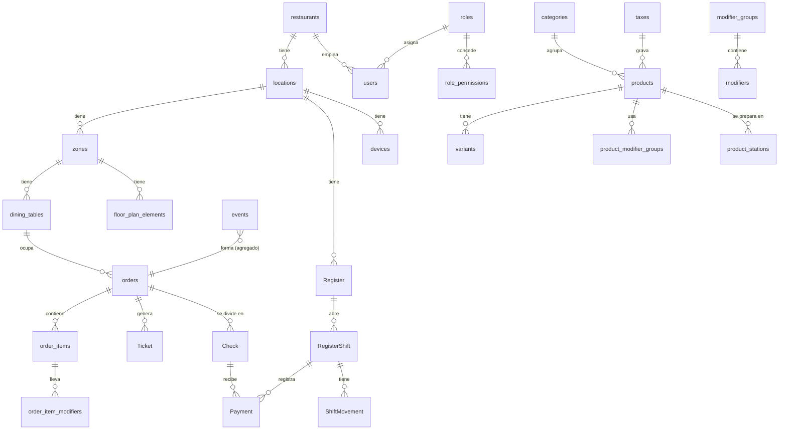

# Modelo de datos

Entidades del sistema y cómo se relacionan. Las fórmulas de dinero están en [DINERO.md](DINERO.md). Decisiones de fondo: [ADR-004](DECISIONES.md#adr-004--dinero-en-pesos-enteros-decimales-solo-dentro-del-cálculo-fiscal) (dinero), [ADR-005](DECISIONES.md#adr-005--los-pedidos-son-eventos-que-solo-se-agregan-nada-se-borra) (eventos), [ADR-006](DECISIONES.md#adr-006--ids-ulid-del-dispositivo-el-orden-lo-da-la-secuencia-del-hub) (IDs) y [ADR-008](DECISIONES.md#adr-008--inicio-de-sesión-solo-con-pin-generado-por-el-sistema) (PIN). La sincronización está en [SYNC.md](SYNC.md).

La columna **Fase** dice en qué fase se crea la tabla: la tarea 0.4 migra solo las marcadas **0**; las demás se migran en su fase.

## Convenciones

### Campos comunes

Registros versionados (categoría V):

| Campo | Tipo | Notas |
|---|---|---|
| `id` | texto (ULID) | Generado en el nodo que crea el registro. |
| `restaurant_id` | ULID | En todas las tablas: el sistema será multirestaurante. |
| `created_at`, `updated_at` | texto ISO 8601 UTC | Hora del hub. |
| `version` | entero | Valor del contador global de cambios del catálogo al guardar (ver [SYNC.md](SYNC.md#catálogo-y-configuración)). |
| `user_id`, `device_id` | ULID | Quién hizo el último cambio y desde dónde. |
| `active` | booleano | Los registros se archivan, nunca se borran. También en las tablas de unión. |

Los **eventos** (categoría E) no llevan `updated_at` ni `version` porque nunca cambian: llevan el sobre descrito en [SYNC.md](SYNC.md#sobre-del-evento).

### Tipos

| Dato | Cómo se guarda | Ejemplo |
|---|---|---|
| Dinero | **Entero en pesos, ≥ 0**. Con signo solo `rounding_adjustment` y `variance` del turno. Límites en [DINERO.md](DINERO.md#principios) | `40900` = $40.900 |
| Valores fiscales del documento DIAN | Entero en **centésimas de peso** | `3787037` = $37.870,37 |
| Porcentajes y tarifas | Entero en **puntos básicos** (1 % = 100) | `800` = 8 % |
| Cantidad vendida | Entero de unidades, > 0. No se vende por peso. | `2` |
| Cantidad de insumo (Fase 2) | Entero en **milésimas** de la unidad base (con signo en movimientos) | 7,5 g → `7500` |
| Fracción (ítem compartido) | Numerador y denominador enteros | 1/3 de botella → `{ n: 1, d: 3 }` |
| Fecha y hora | Texto ISO 8601 en UTC | `2026-10-23T22:09:18.939Z` |
| Día operativo | Texto `AAAA-MM-DD` | venta a la 1 a. m. del 24 → `2026-10-23` |
| Estados y tipos | Texto de una lista cerrada definida en `packages/core` | `'open'` |

No hay ningún número con decimales en la base de datos. Los cálculos intermedios que multiplican montos (repartos, desglose fiscal) usan `BigInt` y devuelven enteros seguros; los esquemas Zod rechazan fracciones, negativos donde no corresponde y enteros fuera de rango.

### Categorías

| Categoría | Qué es | Reglas |
|---|---|---|
| **E** · evento | Hecho que solo se agrega. Una sola tabla `events` para todo (pedidos, mesas, productos, caja, conciliación, auditoría). | **Ni `UPDATE` ni `DELETE`.** Una prueba automática lo verifica. |
| **P** · proyección | Estado calculado a partir de eventos (pedido, ítems, cuentas, pagos, turnos). | Tabla materializada en el hub y en el dispositivo. Se puede borrar y reconstruir aplicando los eventos en orden (comando `rebuild`). |
| **V** · versionado | Catálogo y configuración. | Lo escribe solo el hub (Fase 0–1) o la nube (Fase 2 en adelante). Se archiva, no se borra. Cada cambio también se registra como evento `CatalogChanged` (antes y después), que sirve de historial para validar precios copiados y de auditoría. |
| **L** · local | Datos propios de un nodo que nunca se sincronizan. | Credenciales, sesiones, colas, cursores. |

## Diagrama del núcleo (fases 0 y 1)

## Organización y salón

| Entidad | Fase | Cat. | Campos principales |
|---|---|---|---|
| `restaurants` | 0 | V | `name`, `nit`, `config` (ver [Configuración](#configuración-del-restaurante)) |
| `locations` | 0 | V | `name`, `address`, `time_zone` (`America/Bogota`) |
| `zones` | 0 | V | `location_id`, `name`, `position`, `level` |
| `dining_tables` | 0 | V | `zone_id`, `name` ("12", único entre las mesas activas del restaurante), `shape` (`round`, `square`, `rectangular`, `bar`), `x`, `y` (esquina superior izquierda), `width`, `height`, todo en **centímetros enteros**; `rotation` (grados enteros, alrededor del centro), `capacity` |
| `floor_plan_elements` | 1 | V | `zone_id`, `type` (`wall`, `door`, `plant`, `bar`, `text`), `text` (solo el de tipo texto), geometría igual que `dining_tables`. Parte del esquema de la migración 1 |
| `devices` | 0 | V | `location_id`, `name`, `type` (`waiter`, `register`, `kds`), `paired_at` (desde la 1.3b, cuándo lo registró el hub al entrar por primera vez), `revoked_at`, `revocation_sequence`, `station_ids` (solo las pantallas de cocina: qué estaciones muestran, ADR-015) |
| `device_credentials` | 0 | L (hub) | `device_id`, `token_hash` |

El plano se edita desde la caja con la misma API que el catálogo (`POST /api/catalog/changes`, permiso `edit_catalog`). El hub no deja archivar una mesa con un pedido abierto ni una zona con mesas activas. Los cambios del plano no van al historial `catalog_changes` (no afectan precios).

El estado de una mesa (libre, ocupada, con pedido enviado, precuenta, por pagar, sucia, unida a otra) **no se guarda en `dining_tables`**: es la proyección `TableStatus`, calculada a partir de los pedidos abiertos y de los eventos de mesa.

## Usuarios y permisos

| Entidad | Fase | Cat. | Campos principales |
|---|---|---|---|
| `users` | 0 | V | `name`, `role_id`, `screen` (1 en el usuario técnico de una pantalla de cocina: no es una persona, no sale en Personal ni entra con PIN o contraseña, ADR-015) |
| `user_credentials` | 0 | L (hub) | `user_id`, `pin_hash` (HMAC-SHA256 del PIN con la clave del hub; única entre usuarios activos), `pin_generated_at`. Desde la tarea 1.3b (hoy parte del esquema de la migración 1): `username` (en minúsculas, único entre los activos **de cada restaurante**) y `password_hash` (scrypt con sal), que van juntos, y `password_changed_at`. Sin usuario, la persona entra con su PIN; con usuario, entra con usuario y contraseña y su PIN solo autoriza ([ADR-013](DECISIONES.md#adr-013--acceso-por-rol-meseros-con-pin-desde-la-ip-caja-con-usuario-y-contraseña)). Ni el PIN ni la contraseña escritos se guardan o se registran. |
| `roles` | 0 | V | `name`, `system` (los de fábrica no se renombran ni se archivan; sus permisos sí cambian), `hidden` (el rol «Pantalla de cocina», con `SCREEN_PERMISSIONS`: no se ve, no se edita ni se asigna a personas) |
| `role_permissions` | 0 | V | `role_id`, `permission` |
| `sessions` | 0 | L (hub) | `user_id`, `device_id`, `secret_hash`, `start`, `last_used` (avanza también con los eventos recibidos), `closed_at` |
| `authorizations` | 0 | L (hub) | Comprobante de un solo uso emitido cuando un supervisor escribe su PIN: `supervisor_id`, `action`, `aggregate_id`, `event_id` que autoriza, `content_hash` (huella SHA-256 del evento exacto que se autorizó), `session_id` que lo pidió, `issued_at`, `used_at`. Al aceptar el evento, el hub copia el supervisor en `authorized_by_id` del evento. |
| `Marcacion` | 1 | E | Evento `MarcacionRegistrada`: `user_id`, `type` (`entrada`, `salida`) |

Las tablas de credenciales **solo existen en el hub** y nunca se sincronizan (ADR-008).

### Permisos

Las claves de permiso son fijas y están definidas en `packages/core`, con su nombre para la pantalla (`PERMISSION_DESCRIPTIONS`). **Qué roles las tienen lo decide cada restaurante** en la pantalla **Personal y roles** (`role_permissions`, tarea 1.3b): el administrador crea los roles que quiera y marca sus permisos. Siempre debe quedar al menos una persona activa, con usuario y contraseña, que pueda `manage_users`.

Quien entra con PIN no puede tener ningún permiso de `PASSWORD_PERMISSIONS` (cobrar, anular pagos, cerrar mesas, reabrir cuentas, turnos y movimientos de caja, abrir el cajón, editar la carta o los precios, ver reportes, administrar personal o equipos): el hub no lo deja entrar con PIN y no deja guardar una persona o un rol que quede así.

Los cuatro roles de fábrica ([ADR-013](DECISIONES.md#adr-013--acceso-por-rol-meseros-con-pin-desde-la-ip-caja-con-usuario-y-contraseña)) son solo el punto de partida de un restaurante nuevo:

| Permiso | Administrador | Cajero | Reportes | Mesero |
|---|:-:|:-:|:-:|:-:|
| `take_order` (abrir, agregar, enviar, mover, unir) | ✓ | ✓ | | ✓ |
| `remove_unsent_item` | ✓ | ✓ | | ✓ |
| `void_sent_item` | ✓ | ✓ | | |
| `cancel_order` | ✓ | | | |
| `apply_discount` | ✓ | ✓ | | |
| `comp` | ✓ | | | |
| `reassign_table` | ✓ | ✓ | | |
| `split_check` | ✓ | ✓ | | |
| `record_payment` | ✓ | ✓ | | |
| `void_payment` | ✓ | | | |
| `close_table` | ✓ | ✓ | | |
| `reopen_check` | ✓ | | | |
| `open_register_shift`, `close_register_shift` | ✓ | ✓ | | |
| `cash_movement` | ✓ | ✓ | | |
| `open_drawer_no_sale` | ✓ | | | |
| `mark_preparation` (en preparación, listo, entregado) | ✓ | | | ✓ |
| `mark_product_sold_out` | ✓ | ✓ | | |
| `edit_catalog`, `edit_prices` | ✓ | | | |
| `manage_users`, `manage_devices` | ✓ | | | |
| `view_reports` | ✓ | | ✓ | |
| `view_own_reports` | | ✓ | | ✓ |

Un hub de antes de la 1.3b conserva lo suyo: Contador pasa a llamarse Reportes, y Gerente y Cocina quedan como roles propios del restaurante, con sus permisos y su gente. Los permisos de los roles que ya existían no se tocan.

Una acción está permitida si el usuario tiene el permiso **o** si el evento trae un comprobante válido de un supervisor que lo tiene. Reglas adicionales: pagos, cierres y movimientos de caja **solo desde un dispositivo `register`** (un equipo pasa a ser de caja cuando alguien entra en él con usuario y contraseña); el supervisor no puede autorizarse a sí mismo.

## Catálogo

| Entidad | Fase | Cat. | Campos principales |
|---|---|---|---|
| `categories` | 0 | V | `name`, `position`, `station_id` por defecto, `photo` |
| `products` | 0 | V | `category_id`, `name`, `description`, `price` (pesos, ≥ 0, **incluye impuesto**), `tax_id`, `photo` (opcional, desde la 1.3c: nombre del archivo en `data/photos/` del hub, que es la huella de su contenido; se cambia solo con `POST /api/catalog/photos`), `favorite` |
| `variants` | 0 | V | `product_id`, `name` ("Copa", "Botella"), `price` (reemplaza el del producto), `position`. Si un producto tiene variantes, el ítem del pedido **debe** elegir una ([DINERO.md](DINERO.md#precio-copiado)) |
| `modifier_groups` | 0 | V | `name` ("Término", "Sabor", "Adicionales"), `minimum`, `maximum` (sabor obligatorio: 1 y 1) |
| `product_modifier_groups` | 0 | V | `product_id`, `group_id`, `position` |
| `modifiers` | 0 | V | `group_id`, `name`, `extra_price` (pesos, **≥ 0**; no hay modificadores que resten) |
| `stations` | 0 | V | `name` (cocina, barra), `position` |
| `product_stations` | 0 | V | `product_id`, `station_id` (un producto puede ir a varias) |
| `taxes` | 0 | V | `name`, `type` (`inc`, `iva`, `exempt`), `rate` (puntos básicos) — **(validar)** con contador |
| `Combo` | 1 | V | `product_id` del combo, ítems incluidos y su reparto de precio en pesos (suma exacta) |
| `PrecioCanal` | 1 | V | `product_id`/`variant_id`, `channel`, `price`, franja horaria (happy hour, brunch). La franja se evalúa con la hora del hub. |

Agotado (86) no es un campo editable: son los eventos `ProductSoldOut` / `ProductAvailable` (agregado `product`, desde la tarea 1.3), y la proyección `DisponibilidadProducto`, que cada equipo calcula con los eventos que tiene: lo confirmado en el orden del hub y, encima, lo propio pendiente. Sin `variant_id` se agota el producto entero; con ella, solo esa variante.

**Historial del catálogo** (tarea 1.1): cada cambio de un registro del catálogo deja una fila en la tabla inmutable `catalog_changes` del hub, con la versión que tomó del contador, la entidad, el registro, cómo estaba (`before`), cómo quedó (`after`), quién, desde qué equipo y cuándo. Ese es el `CatalogChanged` de la tabla de eventos de abajo. No va a la tabla `events` ni a la secuencia de los dispositivos: a ellos les llega el aviso `catalog` ([SYNC.md](SYNC.md#catálogo-y-configuración)). Con el historial, el hub sabe qué precio valía en cada `catalog_version` ([DINERO.md](DINERO.md#precio-copiado)). Al crearse (tarea 1.1) se llenó con el estado de cada registro en ese momento; hoy la tabla es parte del esquema de la migración 1.

## Configuración del restaurante

`restaurants.config` es un objeto validado con Zod. Parámetros de dinero y operación (valores por defecto del piloto):

| Parámetro | Por defecto | Notas |
|---|---|---|
| `business_day_start` | `"06:00"` | En la zona horaria de la sede. |
| `table_lock_by_waiter` | `false` | ADR-011. |
| `cash_rounding` | `100` | Múltiplo en pesos para cobros en efectivo (ADR-004). |
| `suggested_tip` | `1000` (10 %) | Puntos básicos. |
| `tip_base` | `'pre_tax'` | Sobre la base sin INC (decisión del dueño) — **(validar)** tope legal con contador. |
| `tax_granularity` | `'line'` | Cómo se desglosa la base: por línea o por documento — **(validar)** con proveedor DIAN. |
| `sales_by_waiter` | `'added_by'` | A quién se cuentan las ventas en los reportes (las propinas van al fondo común). |
| `rounding_mode` | `'half_up'` | Redondeo de porcentajes y del desglose fiscal ([DINERO.md](DINERO.md#principios)). |
| `cash_rounding_mode` | `'nearest_half_down'` | Al múltiplo más cercano; la mitad, a favor del cliente. |
| `session_idle_min` | `30` | Minutos sin uso para cerrar la sesión en un dispositivo compartido. |
| `courses_enabled` | `false` | Si se toman pedidos por curso (entrada, fuerte, postre; retener y marchar). Apagado: no se ve «Curso» al tomar el pedido (ADR-011). |
| `kitchen_yellow_min` / `kitchen_red_min` | `10` / `20` | Minutos desde el envío tras los que lo de cocina pasa a ámbar y a rojo en «Pedidos en cocina» y en la pantalla de cocina (ADR-015). Se cambian en «Cocina e impresoras». |
| `brand` | `"faro"` | Con qué marca se ve el POS en todos los equipos (ADR-014): `faro` o una marca preparada (`la-spritzzeria`). La cambia el administrador en «Marca del restaurante». |
| `payment_methods` | efectivo, tarjeta, Nequi, Daviplata, Bre-B, transferencia | Los que salen al cobrar, en ese orden (tarea 1.6). El efectivo siempre está. Se cambian en «Caja y pagos». |
| `pre_bill_printer_id` | `null` | Dónde sale la precuenta; sin impresora, solo se ve en pantalla (tarea 1.6). |
| `register_variance_threshold` | `1000` | Desde qué diferencia (sobrante o faltante) el cierre de caja pide justificación (tarea 1.7). |
| `custom_methods` | `[]` | Medios que crea el restaurante, con `id`, `name` y `active` (hasta 20). Un pago con uno de ellos va con `method: 'other'` y `custom_method_id`. |

## Eventos

### Tabla `events`

Una sola tabla para todos los eventos. Columnas = el sobre de [SYNC.md](SYNC.md#sobre-del-evento): `id`, `type`, `schema_version`, `aggregate_type` (`order`, `table`, `product`, `catalog`, `register_shift`, `user`, `system`; desde la Fase 1 también `card_terminal`, `reconciliation` y, en la Fase 2, `document`), `aggregate_id`, `related`, `data`, `session_id`, `user_id`, `device_id`, `authorization_id`, `reason`, `device_time`, `hub_estimated_time`, `base_sequence`, y lo que agrega el hub: `sequence`, `received_at`, `business_day`, `assignments`, `affects` (pedidos a los que se aplica, resuelto por el hub) y `authorized_by_id`.

`reason` vive solo en el sobre (no dentro de `data`). Los eventos que emite el propio hub usan el usuario y dispositivo `system`.

### Eventos del pedido (versión 1)

Cada tipo tiene su esquema Zod en `packages/core` (tarea 0.5). Los montos que salen de un cálculo (descuentos, divisiones, propinas sugeridas) **se guardan ya calculados en pesos dentro del evento**; la proyección solo los lee. Así, cambiar una fórmula en una versión futura nunca altera pedidos pasados.

| Evento | Datos principales | Permiso |
|---|---|---|
| `OrderOpened` | `channel`, `table_id`, `guests` | `take_order` |
| `WaiterAssigned` | `waiter_id` | `reassign_table` si no es al abrir |
| `GuestsChanged` | `guests` | `take_order` |
| `OrderNoteChanged` | `notes` (para todo el pedido: alergias, celebraciones; `null` la quita). Sale en cada comanda que se envíe después y en la pantalla de cocina | `take_order` |
| `ItemAdded` | `item_id`, `product_id`, `catalog_version`, `price_channel_id`, `variant_id`, **copias** de nombre y `unit_price`, **copia del impuesto** (`tax_type`, `rate`), `quantity`, `guest`, `course`, `modifiers` (con nombre y `extra_price` copiados; heredan el impuesto del ítem), `notes`. Nace `held` si su curso está retenido. | `take_order` |
| `ItemChanged` | `item_id`, nueva `quantity` / `guest` / `course` / `notes` — solo antes de enviar | `take_order` |
| `ItemRemoved` | `item_id` — solo antes de enviar; es también el "deshacer" | `remove_unsent_item` |
| `ItemsSent` | `tickets`: `[{ ticket_id, station_id, item_ids }]` | `take_order` |
| `ItemModifiedAfterSend` | `item_id`, cambio (notas, modificadores), `ticket_id` de modificación | `take_order` |
| `TicketReprinted` | `ticket_id` | `take_order` |
| `CourseHeld` / `CourseFired` | `course` | `take_order` |
| `ItemInPreparation` / `ItemReady` / `ItemServed` | `item_ids` | `mark_preparation` |
| `ItemReturnedToQueue` | `item_ids` (recuperar algo marcado listo por error) | `mark_preparation` |
| `ItemVoided` | `item_id`, `quantity` (anulación parcial: 1 de 3), `already_prepared` (si es merma), `ticket_id` de anulación | `void_sent_item` |
| `ItemsMoved` | `target_order_id`, **copia completa** de los ítems movidos (incluido `added_by`); va en el pedido origen con el destino en `related`. Los ítems conservan su `item_id`. | `take_order` |
| `OrderMovedTable` | `target_table_id` | `take_order` |
| `TablesMerged` / `TablesSeparated` | `table_ids`: mesas que el pedido ocupa además de la suya (un grupo grande, tarea 1.5). Van en el agregado del pedido, no en uno de mesa: el pedido es lo que ocupa las mesas. El hub no deja unir una mesa con otro pedido abierto. Un pedido ocupa sus mesas mientras tenga algo vigente o no tenga nada (recién abierto, o con lo no enviado quitado); pasar todo a otra mesa (`emptiedOnMove`) o anularlo todo las suelta. Cualquier evento que vuelva a ocupar una mesa (reabrir, agregar a un pedido vaciado) pasa por la misma revisión | `take_order` |
| `OrdersMerged` | `source_order_id`, copia de sus ítems; solo si el origen no tiene pagos ni división | `take_order` |
| `DiscountApplied` | `discount_id`, `scope` (`item`, `order`), `item_id`, `rule` (`percent` o `value`, informativa), `unit_count` (cortesía de 1 de 3), **`amounts`: pesos por línea ya prorrateados** ([DINERO.md](DINERO.md#descuentos)) | `apply_discount` o `comp` |
| `DiscountRemoved` | `discount_id` | `apply_discount` |
| `PreBillPrinted` | `check_id` (opcional), `subtotal`, `suggested_tip` en **pesos** tal como se imprimió | `take_order` |
| `CheckSplit` | `checks`: `[{ check_id, name, items (con fracción `{n, d}` en el ítem compartido), amount, suggested_tip }]` en pesos, calculados sobre el saldo; lo no asignado queda en `unassigned` y los pagos previos en `general` ([DINERO.md](DINERO.md#división-de-la-cuenta)) | `split_check` |
| `SplitUndone` | — (solo si ninguna cuenta tiene pagos) | `split_check` |
| `PaymentRecorded` | `payment_id`, `check_id`, `register_shift_id`, `method`, `amount`, `tip`, `tendered`, `change`, `rounding_adjustment` con la regla `rounding` (múltiplo y modo) que lo produjo, datos del datáfono (obligatorios con tarjeta; desde la 1.6 el número de aprobación es opcional y va `card_type`: crédito o débito), `charge_reference`, `custom_method_id` (con `method: 'other'`). El hub rechaza un medio apagado, un medio propio archivado y un datáfono que no está activo | `record_payment` |
| `PaymentVoided` | `payment_id`, `register_shift_id` del turno **actual** (donde cae la reversa) | `void_payment` |
| `RefundRecorded` | `payment_id`, `sale_amount`, `tip_amount` (topes en [DINERO.md](DINERO.md#pagos)), `method`, `register_shift_id` | `void_payment` |
| `RescueOrderCreated` | `original_order_id`, `waiter_id` (el del pedido original); lo emite el hub con un ID nuevo cuando llegan ítems a un pedido ya cerrado | — |
| `OrderClosed` | — (solo con saldo 0) | `close_table` |
| `OrderReopened` | — (si ya hubo documento DIAN, la diferencia va en una nota) | `reopen_check` |
| `OrderCanceled` | — (solo sin pagos vigentes) | `cancel_order` |

### Eventos de mesa, producto y caja

| Evento | Agregado | Datos principales | Permiso |
|---|---|---|---|
| `MesaMarcadaSucia` / `MesaLimpia` | table | — | `take_order` |
| `ProductSoldOut` / `ProductAvailable` | product | `product_id`, `variant_id` | `mark_product_sold_out` |
| `ShiftOpened` | register_shift | `register_id`, `base` (pesos). Desde la tarea 1.6 la caja es el equipo de caja donde se abre (`register_id` = su `device_id`). El hub no deja abrir un segundo turno en una caja que ya tiene uno, y un pago, anulación o reembolso solo cae en un turno abierto de la caja que lo registra | `open_register_shift` |
| `CashMovementRecorded` | register_shift | `movement_id`, `type` (desde la 1.7: `cash_in`, `cash_out`, `tip_payout`; después `partial_withdrawal` y `apertura_cajon`), `amount`, `description`; en `tip_payout`, `to_whom` y los `days` del fondo | `cash_movement` o `open_drawer_no_sale` |
| `CatalogChanged` | catalog | `entity`, `record_id`, `before`, `after`, `catalog_version`. Se guarda en `catalog_changes`, no en `events` (ver [Catálogo](#catálogo)) | `edit_catalog`, o `edit_prices` si solo cambian precios |
| `CashCountRecorded` | register_shift | `cash_count_id`, `tally` (`[{ value, quantity }]`, el billete y la moneda del mismo valor juntos) y `counted_cash`, que debe sumar el conteo; desde la 1.8, `others` con lo que dice el cierre de cada medio que no es efectivo (`method`, `custom_method_id`, `reported`). Cada conteo queda, aunque se vuelva a contar | `close_register_shift` |
| `ShiftClosed` | register_shift | `cash_count_id` (el conteo con que se cierra), `expected_cash`, `counted_cash`, `variance` (contado − esperado, con signo) y `justification` (obligatoria desde `register_variance_threshold`). Desde la 1.8, `other_methods`: por medio, `expected` (venta + propina registradas), `reported` (lo del conteo) y `variance`. El hub lo rechaza si el esperado no es el suyo, si el contado no es el del último arqueo o si los demás medios no son los que él calcula (`other_methods_mismatch`) | `close_register_shift` |
| `ConflictoDetectado` | el del evento | `type` (lista cerrada abajo), `event_id`, descripción — lo emite el hub, uno por evento | — |
| `ConflictoResuelto` | el del evento | `conflicto_id`, `resolution` | `close_table` |

Tipos de conflicto (solo situaciones causadas por un dispositivo desactualizado): `duplicate_table`, `table_locked`, `item_not_found`, `item_already_sent`, `item_already_voided`, `item_moved`, `order_closed`, `price_mismatch`. Los errores de pago (monto mayor que el saldo, pago ya anulado, sin turno abierto) son **rechazos**: los pagos solo salen de la caja, que está conectada al hub.

### Reglas de aplicación

- `applyEvent(status, event)` (`packages/core/src/order/apply.ts`) es **total y determinista**: nunca lanza error y da el mismo resultado en celular, hub y nube. Cuando no puede aplicar un evento devuelve el estado sin cambios y un `issue` (`IssueType`); con eso el hub decide si es rechazo o conflicto.
- Un evento válido que no se puede aplicar al estado (por ejemplo anular un ítem ya anulado) **no cambia la proyección**, se guarda igual y el hub emite un `ConflictoDetectado`.
- Un ítem agregado a un pedido que ya estaba cerrado va a un **pedido de rescate**: el hub emite `RescueOrderCreated` y pone el rescate en `affects` del evento, con conflicto `order_closed`; no cuenta como venta hasta cobrarse.
- Un evento sobre un ítem que se movió a otro pedido se aplica donde esté el ítem: el hub lo resuelve y lo pone en `affects`, con conflicto informativo `item_moved`.
- Con descuentos en la línea o el pedido dividido, cambiar cantidad, anular, mover o agregar extras con precio exige antes `DiscountRemoved` o `SplitUndone`.
- Con el pedido cerrado o cancelado solo valen los eventos que no tocan montos (cocina: en preparación, listo, entregado, devuelto a la cola; reimpresión de comanda y de precuenta). Todo lo demás, incluidos anulaciones, pagos y reembolsos, exige reabrirlo primero.
- Un evento con una secuencia ya aplicada se ignora (`event_already_applied`), y un evento que no toca al pedido no se aplica (`foreign_event`).
- Un cambio de estado de varios ítems (enviar, listo, entregado) se aplica a los que pueden y avisa con `items_omitted` de los demás; el mesero puede marcar entregado directo desde enviado (estaciones sin KDS).
- Al mover o unir, la copia de cada ítem debe coincidir con el ítem real del origen (precio, extras, cantidad, anulado, estado, quién lo agregó); unir trae todos los ítems y exige que el origen no tenga pagos ni descuentos. El hub valida los dos pedidos antes de aceptar el evento.
- Ningún pedido pasa de $10.000.000.000 en bruto.
- Un pago con reembolsos ya no se anula, y devolver toda la venta de un pago en efectivo con ajuste de redondeo se hace anulando el pago.
- Anular un ítem que dejaría el saldo negativo se rechaza: primero se anula el pago o se registra un reembolso.
- No se mueven ítems que ya están pagados en una cuenta.

## Proyecciones del pedido y del cobro

| Entidad | Fase | Cat. | Campos principales |
|---|---|---|---|
| `orders` | 0 | P | `channel`, `table_id`, `day_number` (del hub, ver asignaciones), `provisional_number`, `guests`, `assigned_waiter_id`, `status` (`open`, `closed`, `canceled`), `opened_at`, `closed_at`, `business_day` (el del **primer** cierre), `rescue_order_of` |
| `order_items` | 0 | P | `order_id`, `product_id`, `variant_id`, `name`, `unit_price`, `tax_type`, `rate`, `quantity`, `voided_quantity` (anulación parcial; la cantidad original se conserva para los informes), `guest`, `course`, `status` (`held`, `pending`, `sent`, `in_preparation`, `ready`, `served`, `voided`), `added_by` (mesero), `notes`, `station_ids` |
| `order_item_modifiers` | 0 | P | `order_item_id`, `modifier_id`, `name`, `extra_price` |
| `Ticket` | 1 | P | `order_id`, `station_id`, `number` (del hub), `type` (`new`, `reprint`, `modification`, `void`, `note`, `move`), `items` |
| `Check` | 1 | P | `order_id`, `name`, ítems o montos asignados, `total`, `paid`, `balance` |
| `OrderDiscount` | 1 | P | `order_id`, `item_id`, `amounts` por línea, `reason`, supervisor que autorizó |
| `Payment` | 1 | P | Proyección de `PaymentRecorded` / `PaymentVoided` / `RefundRecorded`: todos sus campos más `voided` |
| `FondoPropinas` | 1 | P | Por `business_day`: propinas del día por medio, pagos (`tip_payout`) y **saldo acumulado** que pasa al día siguiente. El reparto lo decide el equipo fuera del sistema (reglas automáticas en Fase 5). |
| `RegisterShift` | 1 | P | `register_id`, `cajero_id`, `base`, `opened_at`, `closed_at`, `business_day`, esperado / contado / diferencia por medio, `justification` |
| `TableStatus` | 1 | P | Estado de color de cada mesa, unión de mesas, tiempo ocupada, total actual |
| `conflicts` | 0 | P | Conflictos abiertos para la caja |

### Reglas de dinero del cobro

Están en [DINERO.md](DINERO.md#pagos): monto y saldo, efectivo con `tendered = amount + rounding_adjustment + tip + change`, redondeo a $100 solo en el pago que deja el saldo en 0, turnos, reembolsos y día operativo.

## Datáfonos y conciliación (Fase 1)

| Entidad | Cat. | Campos principales |
|---|---|---|
| `card_terminals` | V | Desde la tarea 1.6 (hoy parte del esquema de la migración 1): `name` y `provider` (`bold`, `redeban`, `credibanco`, `other`). En la 1.8: `terminal` y `nivel_integracion` (1 manual, 2 Bold API, 3 Redeban integrado) |
| `TransaccionDatafono` | P (de `TransaccionDatafonoRegistrada`, `TransaccionDatafonoAnulada`) | `card_terminal_id`, `approval_code`, `rrn`, `franchise`, `tarjeta_enmascarada`, `amount`, `tip`, **`total`** (lo que aprobó el datáfono), `fecha_hora`, `lote`, `origen` (`manual`, `importada`, `webhook`, `integrada`), `status` |
| `Conciliacion` | P (de `ConciliacionIniciada`, `ConciliacionCerrada`) | `card_terminal_id`, `lote` o rango de fechas (puede abarcar varios turnos), `total_pos`, `total_datafono`, `status` |
| `ConciliacionItem` | P (de `ConciliacionItemMarcado`) | `conciliacion_id`, `pago_ids`, `transaccion_ids` (una pasada de tarjeta puede pagar dos cuentas), `status` (`conciliada`, `solo_pos`, `solo_datafono`, `diferencia_monto`, `duplicada`, `anulada`), `justification` |

Reglas: se concilia `Σ (amount + tip)` de los pagos contra `total` de la transacción. El número de aprobación no se puede repetir para el mismo datáfono y día. El importador usa el formato numérico configurado para cada proveedor y convierte a enteros sin `parseFloat`; rechaza fracciones ([DINERO.md](DINERO.md#datáfonos)).

## Impresión (Fase 1)

Desde la tarea 1.4 ([ADR-015](DECISIONES.md#adr-015--comandas-impresas-por-estación-pantalla-de-cocina-opcional-y-entrega-por-el-mesero)); hoy parte del esquema de la migración 1:

| Entidad | Cat. | Campos principales |
|---|---|---|
| `printers` | V | `name`, `connection` (`network`; `usb` llega con el instalador, 1.13), `address` (IP o nombre del equipo; en USB, el nombre en Windows), `port` (9100 por defecto), `width` (58/80 mm), `code_page` (`pc850`, `wpc1252` o `no_accents`: cómo imprime tildes y eñes cada marca), `fallback_id`, `station_ids` |
| `print_jobs` | L (hub) | `printer_id`, `type` (`ticket`, `test`; `preBill` desde la tarea 1.6 y `report`, el cierre Z, desde la 1.9), `event_id` y `ticket_id` (únicos con la impresora: reintentar el evento no duplica), `content` (la comanda ya resuelta en JSON; se convierte en bytes al imprimir, con el ancho de la impresora que la imprime), `status` (`pending`, `printed`, `discarded`; no se borra), `attempts`, `last_error`, `printed_on_id` (puede ser la de respaldo), `discarded_by_id` |

El cierre Z (tarea 1.9, [KPIS.md](KPIS.md#cierre-z-impreso)) se crea en la transacción de `ShiftClosed`, en la impresora de precuentas, con los montos congelados; una reimpresión desde Reportes va sin `event_id` y dice que es reimpresión.

Una comanda se crea en la misma transacción que el evento que la pide (`ItemsSent`, `TicketReprinted`, `ItemVoided` de algo en cocina, `ItemModifiedAfterSend`), una por impresora activa de su estación. El número de comanda del día lo da el hub en `assignments.ticket_numbers` del envío (uno por estación); la reimpresión, la anulación y la modificación llevan el de la comanda original.

## Facturación electrónica (Fase 2) — (validar) con proveedor y contador

| Entidad | Cat. | Campos principales |
|---|---|---|
| `ResolucionNumeracion` | V | `register_id`, `tipo_documento`, `prefijo`, `desde`, `hasta`, `vigente_desde`, `vigente_hasta`. **El siguiente número no se guarda aquí:** lo calcula el hub a partir de los documentos emitidos, así nunca retrocede. |
| `DocumentoElectronico` | P (de `DocumentoEmitido`, `DocumentoTransmitido`, `DocumentoAceptado`, `DocumentoRechazado`) | `type`, `resolucion_id`, `numero`, `order_id`, `check_id`, `documento_referencia_id` (para notas), `cliente_id`, líneas y totales por tarifa en **centésimas**, `cufe_cude`, `status`, `xml`, `pdf`, `attempts` |
| `Cliente` | V | `tipo_documento`, `numero_documento`, `name`, `correo`, `celular`, `consentimiento_datos` (Ley 1581) |

Los reportes de impuestos **suman los documentos emitidos**; no recalculan sobre totales. Desde la Fase 1, el cierre Z calcula los impuestos con la misma función de `packages/core` que usará el documento.

## Inventario (Fase 2)

| Entidad | Cat. | Campos principales |
|---|---|---|
| `Unidad` | V | `name` (g, ml, unidad), `base` |
| `Insumo` | V | `name`, `unidad_uso`, `unidad_compra`, `factor` (milésimas de la unidad base por unidad de compra; libra = `453592`), `costo` (pesos por unidad de compra), `stock_minimo`, `critico` |
| `Receta` / `RecetaItem` | V | producto o sub-receta; insumo o sub-receta; `quantity` (milésimas), `merma` (puntos básicos), `rendimiento` |
| `Bodega` | V | `name` |
| `MovimientoInventario` | E | `bodega_id`, `insumo_id`, `type`, `quantity` (milésimas, con signo), `costo_total` (pesos), `origen_id` |
| `ConteoFisico` | E | `bodega_id`, conteos, diferencia teórico vs real |
| `Proveedor` | V (Fase 5) | `nit`, `name`, contacto |

El costo teórico de un plato se calcula con fracciones exactas y se redondea **una vez por plato**, no por insumo.

## Auditoría y sincronización

| Entidad | Fase | Cat. | Campos principales |
|---|---|---|---|
| `Auditoria` | 0 | E | Evento `AccionAuditada` para lo que no es de un pedido: `action` (`inicio_sesion`, `pines_fallidos` (conteo agregado por ventana de 10 min, nunca el PIN escrito), `apertura_cajon`, `dispositivo_revocado`, `config_cambiada`, …), `entity`, `entidad_id`, `before`, `after` |
| `rejected_events` | 0 | L (hub) | Eventos rechazados con su motivo y contenido, para revisión y rescate |
| `quarantined_events` | 0 | L (hub) | Eventos de un dispositivo revocado con `hub_estimated_time` anterior a la revocación, o con una sesión que el hub ya no conoce tras restaurarse; esperan a que la caja los acepte o descarte |
| `ColaSalida` | 0 | L | En cada dispositivo (IndexedDB) y en el hub hacia la nube: `event_id`, `status` (`pending`, `enviado`, `confirmed`, `rejected`), `attempts`, `last_error` |
| `CursorSync` | 0 | L | `hub_instance`, último `until` recibido, desfase del reloj con el hub y versión de catálogo, por nodo |
