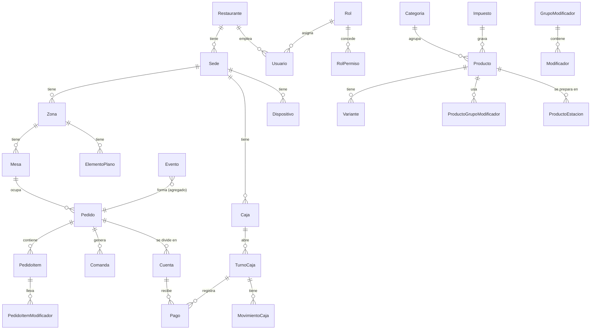

# Modelo de datos

Entidades del sistema y cómo se relacionan. Las fórmulas de dinero están en [DINERO.md](DINERO.md). Decisiones de fondo: [ADR-004](DECISIONES.md#adr-004--dinero-en-pesos-enteros-decimales-solo-dentro-del-cálculo-fiscal) (dinero), [ADR-005](DECISIONES.md#adr-005--los-pedidos-son-eventos-que-solo-se-agregan-nada-se-borra) (eventos), [ADR-006](DECISIONES.md#adr-006--ids-ulid-del-dispositivo-el-orden-lo-da-la-secuencia-del-hub) (IDs) y [ADR-008](DECISIONES.md#adr-008--inicio-de-sesión-solo-con-pin-generado-por-el-sistema) (PIN). La sincronización está en [SYNC.md](SYNC.md).

La columna **Fase** dice en qué fase se crea la tabla: la tarea 0.4 migra solo las marcadas **0**; las demás se migran en su fase.

## Convenciones

### Campos comunes

Registros versionados (categoría V):

| Campo | Tipo | Notas |
|---|---|---|
| `id` | texto (ULID) | Generado en el nodo que crea el registro. |
| `restaurante_id` | ULID | En todas las tablas: el sistema será multirestaurante. |
| `creado_en`, `actualizado_en` | texto ISO 8601 UTC | Hora del hub. |
| `version` | entero | Valor del contador global de cambios del catálogo al guardar (ver [SYNC.md](SYNC.md#catálogo-y-configuración)). |
| `usuario_id`, `dispositivo_id` | ULID | Quién hizo el último cambio y desde dónde. |
| `activo` | booleano | Los registros se archivan, nunca se borran. También en las tablas de unión. |

Los **eventos** (categoría E) no llevan `actualizado_en` ni `version` porque nunca cambian: llevan el sobre descrito en [SYNC.md](SYNC.md#sobre-del-evento).

### Tipos

| Dato | Cómo se guarda | Ejemplo |
|---|---|---|
| Dinero | **Entero en pesos, ≥ 0**. Con signo solo `ajuste_redondeo` y `diferencia` del turno. Límites en [DINERO.md](DINERO.md#principios) | `40900` = $40.900 |
| Valores fiscales del documento DIAN | Entero en **centésimas de peso** | `3787037` = $37.870,37 |
| Porcentajes y tarifas | Entero en **puntos básicos** (1 % = 100) | `800` = 8 % |
| Cantidad vendida | Entero de unidades, > 0. No se vende por peso. | `2` |
| Cantidad de insumo (Fase 2) | Entero en **milésimas** de la unidad base (con signo en movimientos) | 7,5 g → `7500` |
| Fracción (ítem compartido) | Numerador y denominador enteros | 1/3 de botella → `{ n: 1, d: 3 }` |
| Fecha y hora | Texto ISO 8601 en UTC | `2026-10-23T22:09:18.939Z` |
| Día operativo | Texto `AAAA-MM-DD` | venta a la 1 a. m. del 24 → `2026-10-23` |
| Estados y tipos | Texto de una lista cerrada definida en `packages/core` | `'abierto'` |

No hay ningún número con decimales en la base de datos. Los cálculos intermedios que multiplican montos (repartos, desglose fiscal) usan `BigInt` y devuelven enteros seguros; los esquemas Zod rechazan fracciones, negativos donde no corresponde y enteros fuera de rango.

### Categorías

| Categoría | Qué es | Reglas |
|---|---|---|
| **E** · evento | Hecho que solo se agrega. Una sola tabla `Evento` para todo (pedidos, mesas, productos, caja, conciliación, auditoría). | **Ni `UPDATE` ni `DELETE`.** Una prueba automática lo verifica. |
| **P** · proyección | Estado calculado a partir de eventos (pedido, ítems, cuentas, pagos, turnos). | Tabla materializada en el hub y en el dispositivo. Se puede borrar y reconstruir aplicando los eventos en orden (comando `reconstruir`). |
| **V** · versionado | Catálogo y configuración. | Lo escribe solo el hub (Fase 0–1) o la nube (Fase 2 en adelante). Se archiva, no se borra. Cada cambio también se registra como evento `CatalogoCambiado` (antes y después), que sirve de historial para validar precios copiados y de auditoría. |
| **L** · local | Datos propios de un nodo que nunca se sincronizan. | Credenciales, sesiones, colas, cursores. |

## Diagrama del núcleo (fases 0 y 1)

## Organización y salón

| Entidad | Fase | Cat. | Campos principales |
|---|---|---|---|
| `Restaurante` | 0 | V | `nombre`, `nit`, `config` (ver [Configuración](#configuración-del-restaurante)) |
| `Sede` | 0 | V | `nombre`, `direccion`, `zona_horaria` (`America/Bogota`) |
| `Zona` | 0 | V | `sede_id`, `nombre`, `orden`, `piso` |
| `Mesa` | 0 | V | `zona_id`, `nombre` ("12", único entre las mesas activas del restaurante), `forma` (`redonda`, `cuadrada`, `rectangular`, `barra`), `x`, `y` (esquina superior izquierda), `ancho`, `alto`, todo en **centímetros enteros**; `rotacion` (grados enteros, alrededor del centro), `capacidad` |
| `ElementoPlano` | 1 | V | `zona_id`, `tipo` (`pared`, `puerta`, `planta`, `barra`, `texto`), `texto` (solo el de tipo texto), geometría igual que `Mesa`. Tabla `elemento_plano` (migración 4) |
| `Dispositivo` | 0 | V | `sede_id`, `nombre`, `tipo` (`mesero`, `caja`, `kds`), `emparejado_en` (desde la 1.3b, cuándo lo registró el hub al entrar por primera vez), `revocado_en`, `secuencia_revocacion`, `estacion_ids` (solo las pantallas de cocina: qué estaciones muestran, ADR-015) |
| `DispositivoCredencial` | 0 | L (hub) | `dispositivo_id`, `token_hash` |

El plano se edita desde la caja con la misma API que el catálogo (`POST /api/catalogo/cambios`, permiso `editar_catalogo`). El hub no deja archivar una mesa con un pedido abierto ni una zona con mesas activas. Los cambios del plano no van al historial `catalogo_cambio` (no afectan precios).

El estado de una mesa (libre, ocupada, con pedido enviado, precuenta, por pagar, sucia, unida a otra) **no se guarda en `Mesa`**: es la proyección `EstadoMesa`, calculada a partir de los pedidos abiertos y de los eventos de mesa.

## Usuarios y permisos

| Entidad | Fase | Cat. | Campos principales |
|---|---|---|---|
| `Usuario` | 0 | V | `nombre`, `rol_id`, `pantalla` (1 en el usuario técnico de una pantalla de cocina: no es una persona, no sale en Personal ni entra con PIN o contraseña, ADR-015) |
| `UsuarioCredencial` | 0 | L (hub) | `usuario_id`, `pin_huella` (HMAC-SHA256 del PIN con la clave del hub; única entre usuarios activos), `pin_generado_en`. Desde la tarea 1.3b (migración 5): `nombre_usuario` (en minúsculas, único entre los activos **de cada restaurante**) y `contrasena_huella` (scrypt con sal), que van juntos, y `contrasena_cambiada_en`. Sin usuario, la persona entra con su PIN; con usuario, entra con usuario y contraseña y su PIN solo autoriza ([ADR-013](DECISIONES.md#adr-013--acceso-por-rol-meseros-con-pin-desde-la-ip-caja-con-usuario-y-contraseña)). Ni el PIN ni la contraseña escritos se guardan o se registran. |
| `Rol` | 0 | V | `nombre`, `sistema` (los de fábrica no se renombran ni se archivan; sus permisos sí cambian), `oculto` (el rol «Pantalla de cocina», con `PERMISOS_PANTALLA`: no se ve, no se edita ni se asigna a personas) |
| `RolPermiso` | 0 | V | `rol_id`, `permiso` |
| `Sesion` | 0 | L (hub) | `usuario_id`, `dispositivo_id`, `secreto_hash`, `inicio`, `ultimo_uso` (avanza también con los eventos recibidos), `cerrada_en` |
| `Autorizacion` | 0 | L (hub) | Comprobante de un solo uso emitido cuando un supervisor escribe su PIN: `supervisor_id`, `accion`, `agregado_id`, `evento_id` que autoriza, `contenido_hash` (huella SHA-256 del evento exacto que se autorizó), `sesion_id` que lo pidió, `emitida_en`, `usada_en`. Al aceptar el evento, el hub copia el supervisor en `autorizado_por_id` del evento. |
| `Marcacion` | 1 | E | Evento `MarcacionRegistrada`: `usuario_id`, `tipo` (`entrada`, `salida`) |

Las tablas de credenciales **solo existen en el hub** y nunca se sincronizan (ADR-008).

### Permisos

Las claves de permiso son fijas y están definidas en `packages/core`, con su nombre para la pantalla (`DESCRIPCION_PERMISOS`). **Qué roles las tienen lo decide cada restaurante** en la pantalla **Personal y roles** (`RolPermiso`, tarea 1.3b): el administrador crea los roles que quiera y marca sus permisos. Siempre debe quedar al menos una persona activa, con usuario y contraseña, que pueda `administrar_usuarios`.

Quien entra con PIN no puede tener ningún permiso de `PERMISOS_CON_CONTRASENA` (cobrar, anular pagos, cerrar mesas, reabrir cuentas, turnos y movimientos de caja, abrir el cajón, editar la carta o los precios, ver reportes, administrar personal o equipos): el hub no lo deja entrar con PIN y no deja guardar una persona o un rol que quede así.

Los cuatro roles de fábrica ([ADR-013](DECISIONES.md#adr-013--acceso-por-rol-meseros-con-pin-desde-la-ip-caja-con-usuario-y-contraseña)) son solo el punto de partida de un restaurante nuevo:

| Permiso | Administrador | Cajero | Reportes | Mesero |
|---|:-:|:-:|:-:|:-:|
| `tomar_pedido` (abrir, agregar, enviar, mover, unir) | ✓ | ✓ | | ✓ |
| `quitar_item_no_enviado` | ✓ | ✓ | | ✓ |
| `anular_item_enviado` | ✓ | ✓ | | |
| `cancelar_pedido` | ✓ | | | |
| `descontar` | ✓ | ✓ | | |
| `cortesia` | ✓ | | | |
| `reasignar_mesa` | ✓ | ✓ | | |
| `dividir_cuenta` | ✓ | ✓ | | |
| `registrar_pago` | ✓ | ✓ | | |
| `anular_pago` | ✓ | | | |
| `cerrar_mesa` | ✓ | ✓ | | |
| `reabrir_cuenta` | ✓ | | | |
| `abrir_turno_caja`, `cerrar_turno_caja` | ✓ | ✓ | | |
| `movimiento_caja` | ✓ | ✓ | | |
| `abrir_cajon_sin_venta` | ✓ | | | |
| `marcar_preparacion` (en preparación, listo, entregado) | ✓ | | | ✓ |
| `agotar_producto` | ✓ | ✓ | | |
| `editar_catalogo`, `editar_precios` | ✓ | | | |
| `administrar_usuarios`, `administrar_dispositivos` | ✓ | | | |
| `ver_reportes` | ✓ | | ✓ | |
| `ver_reportes_propios` | | ✓ | | ✓ |

Un hub de antes de la 1.3b conserva lo suyo: Contador pasa a llamarse Reportes, y Gerente y Cocina quedan como roles propios del restaurante, con sus permisos y su gente. Los permisos de los roles que ya existían no se tocan.

Una acción está permitida si el usuario tiene el permiso **o** si el evento trae un comprobante válido de un supervisor que lo tiene. Reglas adicionales: pagos, cierres y movimientos de caja **solo desde un dispositivo `caja`** (un equipo pasa a ser de caja cuando alguien entra en él con usuario y contraseña); el supervisor no puede autorizarse a sí mismo.

## Catálogo

| Entidad | Fase | Cat. | Campos principales |
|---|---|---|---|
| `Categoria` | 0 | V | `nombre`, `orden`, `estacion_id` por defecto, `foto` |
| `Producto` | 0 | V | `categoria_id`, `nombre`, `descripcion`, `precio` (pesos, ≥ 0, **incluye impuesto**), `impuesto_id`, `foto` (opcional, desde la 1.3c: nombre del archivo en `datos/fotos/` del hub, que es la huella de su contenido; se cambia solo con `POST /api/catalogo/fotos`), `favorito` |
| `Variante` | 0 | V | `producto_id`, `nombre` ("Copa", "Botella"), `precio` (reemplaza el del producto), `orden`. Si un producto tiene variantes, el ítem del pedido **debe** elegir una ([DINERO.md](DINERO.md#precio-copiado)) |
| `GrupoModificador` | 0 | V | `nombre` ("Término", "Sabor", "Adicionales"), `minimo`, `maximo` (sabor obligatorio: 1 y 1) |
| `ProductoGrupoModificador` | 0 | V | `producto_id`, `grupo_id`, `orden` |
| `Modificador` | 0 | V | `grupo_id`, `nombre`, `precio_extra` (pesos, **≥ 0**; no hay modificadores que resten) |
| `Estacion` | 0 | V | `nombre` (cocina, barra), `orden` |
| `ProductoEstacion` | 0 | V | `producto_id`, `estacion_id` (un producto puede ir a varias) |
| `Impuesto` | 0 | V | `nombre`, `tipo` (`inc`, `iva`, `exento`), `tarifa` (puntos básicos) — **(validar)** con contador |
| `Combo` | 1 | V | `producto_id` del combo, ítems incluidos y su reparto de precio en pesos (suma exacta) |
| `PrecioCanal` | 1 | V | `producto_id`/`variante_id`, `canal`, `precio`, franja horaria (happy hour, brunch). La franja se evalúa con la hora del hub. |

Agotado (86) no es un campo editable: son los eventos `ProductoAgotado` / `ProductoDisponible` (agregado `producto`, desde la tarea 1.3), y la proyección `DisponibilidadProducto`, que cada equipo calcula con los eventos que tiene: lo confirmado en el orden del hub y, encima, lo propio pendiente. Sin `variante_id` se agota el producto entero; con ella, solo esa variante.

**Historial del catálogo** (tarea 1.1): cada cambio de un registro del catálogo deja una fila en la tabla inmutable `catalogo_cambio` del hub, con la versión que tomó del contador, la entidad, el registro, cómo estaba (`antes`), cómo quedó (`despues`), quién, desde qué equipo y cuándo. Ese es el `CatalogoCambiado` de la tabla de eventos de abajo. No va a la tabla `evento` ni a la secuencia de los dispositivos: a ellos les llega el aviso `catalogo` ([SYNC.md](SYNC.md#catálogo-y-configuración)). Con el historial, el hub sabe qué precio valía en cada `catalogo_version` ([DINERO.md](DINERO.md#precio-copiado)). La migración 3 lo llenó con el estado de cada registro en ese momento.

## Configuración del restaurante

`Restaurante.config` es un objeto validado con Zod. Parámetros de dinero y operación (valores por defecto del piloto):

| Parámetro | Por defecto | Notas |
|---|---|---|
| `inicio_dia_operativo` | `"06:00"` | En la zona horaria de la sede. |
| `bloqueo_mesa_por_mesero` | `false` | ADR-011. |
| `redondeo_efectivo` | `100` | Múltiplo en pesos para cobros en efectivo (ADR-004). |
| `propina_sugerida` | `1000` (10 %) | Puntos básicos. |
| `propina_base` | `'sin_impuesto'` | Sobre la base sin INC (decisión del dueño) — **(validar)** tope legal con contador. |
| `granularidad_fiscal` | `'linea'` | Cómo se desglosa la base: por línea o por documento — **(validar)** con proveedor DIAN. |
| `ventas_por_mesero` | `'quien_agrega'` | A quién se cuentan las ventas en los reportes (las propinas van al fondo común). |
| `redondeo_modo` | `'mitad_arriba'` | Redondeo de porcentajes y del desglose fiscal ([DINERO.md](DINERO.md#principios)). |
| `redondeo_efectivo_modo` | `'cercano_mitad_abajo'` | Al múltiplo más cercano; la mitad, a favor del cliente. |
| `sesion_inactividad_min` | `30` | Minutos sin uso para cerrar la sesión en un dispositivo compartido. |
| `usar_cursos` | `false` | Si se toman pedidos por curso (entrada, fuerte, postre; retener y marchar). Apagado: no se ve «Curso» al tomar el pedido (ADR-011). |
| `cocina_amarillo_min` / `cocina_rojo_min` | `10` / `20` | Minutos desde el envío tras los que lo de cocina pasa a ámbar y a rojo en «Pedidos en cocina» y en la pantalla de cocina (ADR-015). Se cambian en «Cocina e impresoras». |
| `marca` | `"faro"` | Con qué marca se ve el POS en todos los equipos (ADR-014): `faro` o una marca preparada (`la-spritzzeria`). La cambia el administrador en «Marca del restaurante». |

## Eventos

### Tabla `Evento`

Una sola tabla para todos los eventos. Columnas = el sobre de [SYNC.md](SYNC.md#sobre-del-evento): `id`, `tipo`, `version_esquema`, `agregado_tipo` (`pedido`, `mesa`, `producto`, `catalogo`, `turno_caja`, `usuario`, `sistema`; desde la Fase 1 también `datafono`, `conciliacion` y, en la Fase 2, `documento`), `agregado_id`, `relacionados`, `datos`, `sesion_id`, `usuario_id`, `dispositivo_id`, `autorizacion_id`, `motivo`, `hora_dispositivo`, `hora_estimada_hub`, `secuencia_base`, y lo que agrega el hub: `secuencia`, `recibido_en`, `dia_operativo`, `asignaciones`, `afecta` (pedidos a los que se aplica, resuelto por el hub) y `autorizado_por_id`.

`motivo` vive solo en el sobre (no dentro de `datos`). Los eventos que emite el propio hub usan el usuario y dispositivo `sistema`.

### Eventos del pedido (versión 1)

Cada tipo tiene su esquema Zod en `packages/core` (tarea 0.5). Los montos que salen de un cálculo (descuentos, divisiones, propinas sugeridas) **se guardan ya calculados en pesos dentro del evento**; la proyección solo los lee. Así, cambiar una fórmula en una versión futura nunca altera pedidos pasados.

| Evento | Datos principales | Permiso |
|---|---|---|
| `PedidoAbierto` | `canal`, `mesa_id`, `comensales` | `tomar_pedido` |
| `MeseroAsignado` | `mesero_id` | `reasignar_mesa` si no es al abrir |
| `ComensalesCambiados` | `comensales` | `tomar_pedido` |
| `NotaPedidoCambiada` | `notas` (para todo el pedido: alergias, celebraciones; `null` la quita). Sale en cada comanda que se envíe después y en la pantalla de cocina | `tomar_pedido` |
| `ItemAgregado` | `item_id`, `producto_id`, `catalogo_version`, `precio_canal_id`, `variante_id`, **copias** de nombre y `precio_unitario`, **copia del impuesto** (`impuesto_tipo`, `tarifa`), `cantidad`, `comensal`, `curso`, `modificadores` (con nombre y `precio_extra` copiados; heredan el impuesto del ítem), `notas`. Nace `retenido` si su curso está retenido. | `tomar_pedido` |
| `ItemCambiado` | `item_id`, nueva `cantidad` / `comensal` / `curso` / `notas` — solo antes de enviar | `tomar_pedido` |
| `ItemQuitado` | `item_id` — solo antes de enviar; es también el "deshacer" | `quitar_item_no_enviado` |
| `ItemsEnviados` | `comandas`: `[{ comanda_id, estacion_id, item_ids }]` | `tomar_pedido` |
| `ItemModificadoTrasEnvio` | `item_id`, cambio (notas, modificadores), `comanda_id` de modificación | `tomar_pedido` |
| `ComandaReimpresa` | `comanda_id` | `tomar_pedido` |
| `CursoRetenido` / `CursoMarchado` | `curso` | `tomar_pedido` |
| `ItemEnPreparacion` / `ItemListo` / `ItemEntregado` | `item_ids` | `marcar_preparacion` |
| `ItemDevueltoACola` | `item_ids` (recuperar algo marcado listo por error) | `marcar_preparacion` |
| `ItemAnulado` | `item_id`, `cantidad` (anulación parcial: 1 de 3), `ya_preparado` (si es merma), `comanda_id` de anulación | `anular_item_enviado` |
| `ItemsMovidos` | `pedido_destino_id`, **copia completa** de los ítems movidos (incluido `agregado_por`); va en el pedido origen con el destino en `relacionados`. Los ítems conservan su `item_id`. | `tomar_pedido` |
| `PedidoMovidoDeMesa` | `mesa_destino_id` | `tomar_pedido` |
| `PedidosUnidos` | `pedido_origen_id`, copia de sus ítems; solo si el origen no tiene pagos ni división | `tomar_pedido` |
| `DescuentoAplicado` | `descuento_id`, `alcance` (`item`, `pedido`), `item_id`, `regla` (`porcentaje` o `valor`, informativa), `cantidad_unidades` (cortesía de 1 de 3), **`montos`: pesos por línea ya prorrateados** ([DINERO.md](DINERO.md#descuentos)) | `descontar` o `cortesia` |
| `DescuentoRetirado` | `descuento_id` | `descontar` |
| `PrecuentaImpresa` | `cuenta_id` (opcional), `subtotal`, `propina_sugerida` en **pesos** tal como se imprimió | `tomar_pedido` |
| `CuentaDividida` | `cuentas`: `[{ cuenta_id, nombre, items (con fracción `{n, d}` en el ítem compartido), monto, propina_sugerida }]` en pesos, calculados sobre el saldo; lo no asignado queda en `sin_asignar` y los pagos previos en `general` ([DINERO.md](DINERO.md#división-de-la-cuenta)) | `dividir_cuenta` |
| `DivisionDeshecha` | — (solo si ninguna cuenta tiene pagos) | `dividir_cuenta` |
| `PagoRegistrado` | `pago_id`, `cuenta_id`, `turno_caja_id`, `medio`, `monto`, `propina`, `recibido`, `cambio`, `ajuste_redondeo` con la regla `redondeo` (múltiplo y modo) que lo produjo, datos del datáfono (obligatorios con tarjeta), `referencia_cobro` | `registrar_pago` |
| `PagoAnulado` | `pago_id`, `turno_caja_id` del turno **actual** (donde cae la reversa) | `anular_pago` |
| `ReembolsoRegistrado` | `pago_id`, `monto_venta`, `monto_propina` (topes en [DINERO.md](DINERO.md#pagos)), `medio`, `turno_caja_id` | `anular_pago` |
| `PedidoRescateCreado` | `pedido_original_id`, `mesero_id` (el del pedido original); lo emite el hub con un ID nuevo cuando llegan ítems a un pedido ya cerrado | — |
| `PedidoCerrado` | — (solo con saldo 0) | `cerrar_mesa` |
| `PedidoReabierto` | — (si ya hubo documento DIAN, la diferencia va en una nota) | `reabrir_cuenta` |
| `PedidoCancelado` | — (solo sin pagos vigentes) | `cancelar_pedido` |

### Eventos de mesa, producto y caja

| Evento | Agregado | Datos principales | Permiso |
|---|---|---|---|
| `MesasUnidas` / `MesasSeparadas` | mesa | `mesa_ids` (grupo grande en el plano) | `tomar_pedido` |
| `MesaMarcadaSucia` / `MesaLimpia` | mesa | — | `tomar_pedido` |
| `ProductoAgotado` / `ProductoDisponible` | producto | `producto_id`, `variante_id` | `agotar_producto` |
| `TurnoAbierto` | turno_caja | `caja_id`, `base` (pesos) | `abrir_turno_caja` |
| `MovimientoCajaRegistrado` | turno_caja | `tipo` (`entrada`, `salida`, `pago_propinas`, `retiro_parcial`, `apertura_cajon`), `monto`; en `pago_propinas`, los días del fondo y a quién se pagó | `movimiento_caja` o `abrir_cajon_sin_venta` |
| `CatalogoCambiado` | catalogo | `entidad`, `registro_id`, `antes`, `despues`, `catalogo_version`. Se guarda en `catalogo_cambio`, no en `evento` (ver [Catálogo](#catálogo)) | `editar_catalogo`, o `editar_precios` si solo cambian precios |
| `ArqueoRegistrado` | turno_caja | `conteo` por denominación (`{ "50000": 3, … }`), `contado` por medio de pago | `cerrar_turno_caja` |
| `TurnoCerrado` | turno_caja | `esperado`, `contado` y `diferencia` **por medio de pago**, `justificacion` | `cerrar_turno_caja` |
| `ConflictoDetectado` | el del evento | `tipo` (lista cerrada abajo), `evento_id`, descripción — lo emite el hub, uno por evento | — |
| `ConflictoResuelto` | el del evento | `conflicto_id`, `resolucion` | `cerrar_mesa` |

Tipos de conflicto (solo situaciones causadas por un dispositivo desactualizado): `mesa_duplicada`, `mesa_bloqueada`, `item_inexistente`, `item_ya_enviado`, `item_ya_anulado`, `item_movido`, `pedido_cerrado`, `precio_distinto`. Los errores de pago (monto mayor que el saldo, pago ya anulado, sin turno abierto) son **rechazos**: los pagos solo salen de la caja, que está conectada al hub.

### Reglas de aplicación

- `aplicarEvento(estado, evento)` (`packages/core/src/pedido/aplicar.ts`) es **total y determinista**: nunca lanza error y da el mismo resultado en celular, hub y nube. Cuando no puede aplicar un evento devuelve el estado sin cambios y un `problema` (`TipoProblema`); con eso el hub decide si es rechazo o conflicto.
- Un evento válido que no se puede aplicar al estado (por ejemplo anular un ítem ya anulado) **no cambia la proyección**, se guarda igual y el hub emite un `ConflictoDetectado`.
- Un ítem agregado a un pedido que ya estaba cerrado va a un **pedido de rescate**: el hub emite `PedidoRescateCreado` y pone el rescate en `afecta` del evento, con conflicto `pedido_cerrado`; no cuenta como venta hasta cobrarse.
- Un evento sobre un ítem que se movió a otro pedido se aplica donde esté el ítem: el hub lo resuelve y lo pone en `afecta`, con conflicto informativo `item_movido`.
- Con descuentos en la línea o el pedido dividido, cambiar cantidad, anular, mover o agregar extras con precio exige antes `DescuentoRetirado` o `DivisionDeshecha`.
- Con el pedido cerrado o cancelado solo valen los eventos que no tocan montos (cocina: en preparación, listo, entregado, devuelto a la cola; reimpresión de comanda y de precuenta). Todo lo demás, incluidos anulaciones, pagos y reembolsos, exige reabrirlo primero.
- Un evento con una secuencia ya aplicada se ignora (`evento_ya_aplicado`), y un evento que no toca al pedido no se aplica (`evento_ajeno`).
- Un cambio de estado de varios ítems (enviar, listo, entregado) se aplica a los que pueden y avisa con `items_omitidos` de los demás; el mesero puede marcar entregado directo desde enviado (estaciones sin KDS).
- Al mover o unir, la copia de cada ítem debe coincidir con el ítem real del origen (precio, extras, cantidad, anulado, estado, quién lo agregó); unir trae todos los ítems y exige que el origen no tenga pagos ni descuentos. El hub valida los dos pedidos antes de aceptar el evento.
- Ningún pedido pasa de $10.000.000.000 en bruto.
- Un pago con reembolsos ya no se anula, y devolver toda la venta de un pago en efectivo con ajuste de redondeo se hace anulando el pago.
- Anular un ítem que dejaría el saldo negativo se rechaza: primero se anula el pago o se registra un reembolso.
- No se mueven ítems que ya están pagados en una cuenta.

## Proyecciones del pedido y del cobro

| Entidad | Fase | Cat. | Campos principales |
|---|---|---|---|
| `Pedido` | 0 | P | `canal`, `mesa_id`, `numero_dia` (del hub, ver asignaciones), `numero_provisional`, `comensales`, `mesero_asignado_id`, `estado` (`abierto`, `cerrado`, `cancelado`), `abierto_en`, `cerrado_en`, `dia_operativo` (el del **primer** cierre), `pedido_rescate_de` |
| `PedidoItem` | 0 | P | `pedido_id`, `producto_id`, `variante_id`, `nombre`, `precio_unitario`, `impuesto_tipo`, `tarifa`, `cantidad`, `cantidad_anulada` (anulación parcial; la cantidad original se conserva para los informes), `comensal`, `curso`, `estado` (`retenido`, `pendiente`, `enviado`, `en_preparacion`, `listo`, `entregado`, `anulado`), `agregado_por` (mesero), `notas`, `estacion_ids` |
| `PedidoItemModificador` | 0 | P | `pedido_item_id`, `modificador_id`, `nombre`, `precio_extra` |
| `Comanda` | 1 | P | `pedido_id`, `estacion_id`, `numero` (del hub), `tipo` (`nueva`, `modificacion`, `anulacion`), `items` |
| `Cuenta` | 1 | P | `pedido_id`, `nombre`, ítems o montos asignados, `total`, `pagado`, `saldo` |
| `Descuento` | 1 | P | `pedido_id`, `item_id`, `montos` por línea, `motivo`, supervisor que autorizó |
| `Pago` | 1 | P | Proyección de `PagoRegistrado` / `PagoAnulado` / `ReembolsoRegistrado`: todos sus campos más `anulado` |
| `FondoPropinas` | 1 | P | Por `dia_operativo`: propinas del día por medio, pagos (`pago_propinas`) y **saldo acumulado** que pasa al día siguiente. El reparto lo decide el equipo fuera del sistema (reglas automáticas en Fase 5). |
| `TurnoCaja` | 1 | P | `caja_id`, `cajero_id`, `base`, `abierto_en`, `cerrado_en`, `dia_operativo`, esperado / contado / diferencia por medio, `justificacion` |
| `EstadoMesa` | 1 | P | Estado de color de cada mesa, unión de mesas, tiempo ocupada, total actual |
| `Conflicto` | 0 | P | Conflictos abiertos para la caja |

### Reglas de dinero del cobro

Están en [DINERO.md](DINERO.md#pagos): monto y saldo, efectivo con `recibido = monto + ajuste_redondeo + propina + cambio`, redondeo a $100 solo en el pago que deja el saldo en 0, turnos, reembolsos y día operativo.

## Datáfonos y conciliación (Fase 1)

| Entidad | Cat. | Campos principales |
|---|---|---|
| `Datafono` | V | `proveedor` (`bold`, `redeban`, `otro`), `terminal`, `nombre`, `nivel_integracion` (1 manual, 2 Bold API, 3 Redeban integrado) |
| `TransaccionDatafono` | P (de `TransaccionDatafonoRegistrada`, `TransaccionDatafonoAnulada`) | `datafono_id`, `aprobacion`, `rrn`, `franquicia`, `tarjeta_enmascarada`, `monto`, `propina`, **`total`** (lo que aprobó el datáfono), `fecha_hora`, `lote`, `origen` (`manual`, `importada`, `webhook`, `integrada`), `estado` |
| `Conciliacion` | P (de `ConciliacionIniciada`, `ConciliacionCerrada`) | `datafono_id`, `lote` o rango de fechas (puede abarcar varios turnos), `total_pos`, `total_datafono`, `estado` |
| `ConciliacionItem` | P (de `ConciliacionItemMarcado`) | `conciliacion_id`, `pago_ids`, `transaccion_ids` (una pasada de tarjeta puede pagar dos cuentas), `estado` (`conciliada`, `solo_pos`, `solo_datafono`, `diferencia_monto`, `duplicada`, `anulada`), `justificacion` |

Reglas: se concilia `Σ (monto + propina)` de los pagos contra `total` de la transacción. El número de aprobación no se puede repetir para el mismo datáfono y día. El importador usa el formato numérico configurado para cada proveedor y convierte a enteros sin `parseFloat`; rechaza fracciones ([DINERO.md](DINERO.md#datáfonos)).

## Impresión (Fase 1)

Desde la tarea 1.4 ([ADR-015](DECISIONES.md#adr-015--comandas-impresas-por-estación-pantalla-de-cocina-opcional-y-entrega-por-el-mesero)), en la migración 6:

| Entidad | Cat. | Campos principales |
|---|---|---|
| `Impresora` | V | `nombre`, `conexion` (`red`; `usb` llega con el instalador, 1.10), `direccion` (IP o nombre del equipo; en USB, el nombre en Windows), `puerto` (9100 por defecto), `ancho` (58/80 mm), `pagina_codigos` (`pc850`, `wpc1252` o `sin_tildes`: cómo imprime tildes y eñes cada marca), `respaldo_id`, `estacion_ids` |
| `TrabajoImpresion` | L (hub) | `impresora_id`, `tipo` (`comanda`, `prueba`), `evento_id` y `comanda_id` (únicos con la impresora: reintentar el evento no duplica), `contenido` (la comanda ya resuelta en JSON; se convierte en bytes al imprimir, con el ancho de la impresora que la imprime), `estado` (`pendiente`, `impreso`, `descartado`; no se borra), `intentos`, `ultimo_error`, `impreso_en_id` (puede ser la de respaldo), `descartado_por_id` |

Una comanda se crea en la misma transacción que el evento que la pide (`ItemsEnviados`, `ComandaReimpresa`, `ItemAnulado` de algo en cocina, `ItemModificadoTrasEnvio`), una por impresora activa de su estación. El número de comanda del día lo da el hub en `asignaciones.numeros_comanda` del envío (uno por estación); la reimpresión, la anulación y la modificación llevan el de la comanda original.

## Facturación electrónica (Fase 2) — (validar) con proveedor y contador

| Entidad | Cat. | Campos principales |
|---|---|---|
| `ResolucionNumeracion` | V | `caja_id`, `tipo_documento`, `prefijo`, `desde`, `hasta`, `vigente_desde`, `vigente_hasta`. **El siguiente número no se guarda aquí:** lo calcula el hub a partir de los documentos emitidos, así nunca retrocede. |
| `DocumentoElectronico` | P (de `DocumentoEmitido`, `DocumentoTransmitido`, `DocumentoAceptado`, `DocumentoRechazado`) | `tipo`, `resolucion_id`, `numero`, `pedido_id`, `cuenta_id`, `documento_referencia_id` (para notas), `cliente_id`, líneas y totales por tarifa en **centésimas**, `cufe_cude`, `estado`, `xml`, `pdf`, `intentos` |
| `Cliente` | V | `tipo_documento`, `numero_documento`, `nombre`, `correo`, `celular`, `consentimiento_datos` (Ley 1581) |

Los reportes de impuestos **suman los documentos emitidos**; no recalculan sobre totales. Desde la Fase 1, el cierre Z calcula los impuestos con la misma función de `packages/core` que usará el documento.

## Inventario (Fase 2)

| Entidad | Cat. | Campos principales |
|---|---|---|
| `Unidad` | V | `nombre` (g, ml, unidad), `base` |
| `Insumo` | V | `nombre`, `unidad_uso`, `unidad_compra`, `factor` (milésimas de la unidad base por unidad de compra; libra = `453592`), `costo` (pesos por unidad de compra), `stock_minimo`, `critico` |
| `Receta` / `RecetaItem` | V | producto o sub-receta; insumo o sub-receta; `cantidad` (milésimas), `merma` (puntos básicos), `rendimiento` |
| `Bodega` | V | `nombre` |
| `MovimientoInventario` | E | `bodega_id`, `insumo_id`, `tipo`, `cantidad` (milésimas, con signo), `costo_total` (pesos), `origen_id` |
| `ConteoFisico` | E | `bodega_id`, conteos, diferencia teórico vs real |
| `Proveedor` | V (Fase 5) | `nit`, `nombre`, contacto |

El costo teórico de un plato se calcula con fracciones exactas y se redondea **una vez por plato**, no por insumo.

## Auditoría y sincronización

| Entidad | Fase | Cat. | Campos principales |
|---|---|---|---|
| `Auditoria` | 0 | E | Evento `AccionAuditada` para lo que no es de un pedido: `accion` (`inicio_sesion`, `pines_fallidos` (conteo agregado por ventana de 10 min, nunca el PIN escrito), `apertura_cajon`, `dispositivo_revocado`, `config_cambiada`, …), `entidad`, `entidad_id`, `antes`, `despues` |
| `EventoRechazado` | 0 | L (hub) | Eventos rechazados con su motivo y contenido, para revisión y rescate |
| `EventoEnCuarentena` | 0 | L (hub) | Eventos de un dispositivo revocado con `hora_estimada_hub` anterior a la revocación, o con una sesión que el hub ya no conoce tras restaurarse; esperan a que la caja los acepte o descarte |
| `ColaSalida` | 0 | L | En cada dispositivo (IndexedDB) y en el hub hacia la nube: `evento_id`, `estado` (`pendiente`, `enviado`, `confirmado`, `rechazado`), `intentos`, `ultimo_error` |
| `CursorSync` | 0 | L | `hub_instancia`, último `hasta` recibido, desfase del reloj con el hub y versión de catálogo, por nodo |
