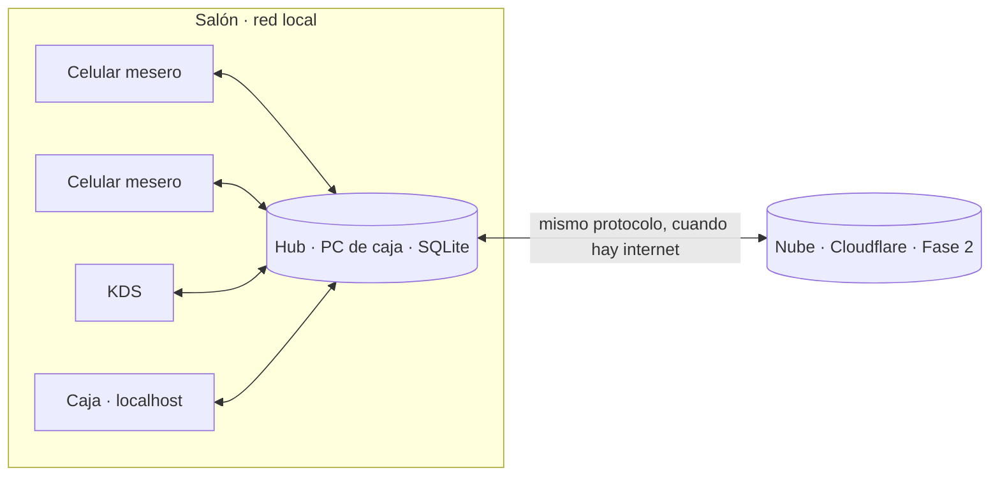
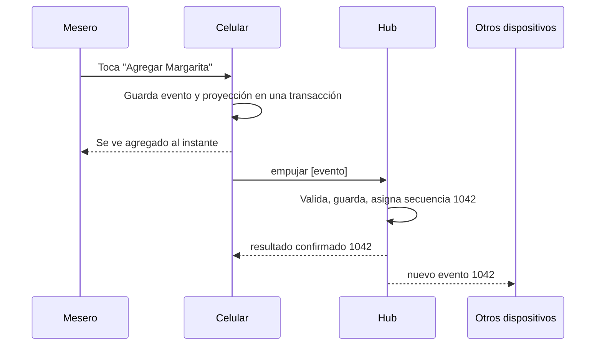

# Sincronización

Cómo viajan los datos entre los celulares, el hub y la nube sin perder ni duplicar nada. Decisión de fondo: [ADR-007](DECISIONES.md#adr-007--sincronización-propia-con-el-mismo-protocolo-en-dos-niveles). Lo aprendido en celulares reales: [ADR-001](DECISIONES.md#adr-001--los-dispositivos-abren-la-app-por-la-ip-del-hub-con-http-y-sin-instalar-nada). Entidades y eventos: [MODELO_DATOS.md](MODELO_DATOS.md).

Se implementa en `packages/sync` (tarea 0.6, dispositivo ↔ hub). El nivel hub ↔ nube usa el mismo protocolo desde la Fase 2.

**Estado de la implementación (0.6):** lógica del hub (`HubSync`, `SalaSync`), almacén SQLite, cliente del dispositivo (`ClienteSync`) y gestor de conexión (`GestorConexion`), probados con una red simulada (escenarios 1 a 13). Diferencias con este documento, por ahora:
- **`foto`**: un dispositivo nuevo o sin datos pide `traer desde: 0`; la foto llega cuando el volumen lo justifique (Fase 1).
- **`ConflictoDetectado`** se registra en la tabla `conflicto` del hub, no como evento; la pantalla de caja lo consultará al hub (Fase 1).
- **Pedido de rescate**: un ítem que llega a un pedido ya cerrado queda como conflicto `pedido_cerrado` (guardado, sin aplicar); el rescate automático llega con la caja (Fase 1).
- **Sesiones y tokens** (tareas 0.7 y 1.3b): entrar, el cierre y las autorizaciones van por la **API HTTP** del hub (`POST /api/entrar`, `/api/sesiones/cerrar`, `/api/autorizaciones`, `/api/dispositivos/:id/revocar`, y el personal en `/api/personal/…`), con el token en `Authorization: Bearer`; no por el WebSocket. El WebSocket solo lleva eventos. El emparejamiento por código (`/api/emparejamientos`, `/api/emparejar`) queda en el hub sin uso: la pantalla de cocina la convierte el administrador con `POST /api/pantallas` (tarea 1.4, ADR-015).
- **Cierre por inactividad**: lo hace el dispositivo (pide el PIN otra vez tras `sesion_inactividad_min`), porque el hub no ve el uso sin conexión. El hub cierra una sesión al cerrarla el usuario, al entrar otra persona en ese dispositivo, al revocar el dispositivo o al archivar al usuario.
- **Eventos de producto** (tarea 1.3): `ProductoAgotado` y `ProductoDisponible` viajan en la misma secuencia que los pedidos (agregado `producto`). El hub los acepta con el permiso `agotar_producto` y no los pasa por el reductor del pedido. Un ítem de un producto agotado que llega de un equipo sin conexión se acepta: todavía no es conflicto.
- **Catálogo** (tarea 1.1): el mensaje `catalogo` solo avisa la versión nueva y el dispositivo pide la carta entera por HTTP (`GET /api/catalogo`, es pequeña); también la pide cada vez que se conecta. Mandar solo los registros cambiados queda para cuando la carta sea grande o la edite la nube (Fase 2).
- **Suscripciones**: por ahora solo hay eventos de pedido y todos los ven; el filtro por tipo de dispositivo y `comanda` llegan con esos datos.
- **WebSocket real e IndexedDB** quedaron conectados en la tarea 0.10: `GET /api/sync/ws` (mensajes de hasta 1 MB, latido cada 5 s, se cierra si no saluda en 10 s) y el almacén del dispositivo en IndexedDB con índices para los pendientes propios y los eventos de cada pedido. El **escenario 14 con dos navegadores (Playwright)** queda para la corrida e2e del final. Los mensajes del hub aún no se validan tipo por tipo en el dispositivo.
- **`afecta`** siempre va vacío: en la Fase 0 ningún evento se aplica fuera de su agregado y sus `relacionados`. Lo mismo los conflictos `item_movido`, `mesa_bloqueada` y `precio_distinto`: llegan con el bloqueo de mesas, mover ítems sin conexión y el catálogo (Fase 1).
- **`hasta_anterior`** de `nuevo` supone que el dispositivo ve todos los eventos; cuando haya vistas por tipo de dispositivo será por dispositivo.
- **Proyecciones del hub**: solo los pedidos abiertos quedan en memoria; los cerrados se reconstruyen de la base al consultarlos. Al arrancar, el hub repasa todos los eventos; en la Fase 1 las proyecciones se guardan en la base para no repasarlo todo.

## Idea en una frase

Cada acción es un **evento** con un código único. Se guarda primero donde se hizo, se envía al hub hasta que este confirme, y el hub le da un **número de secuencia** que define el orden oficial. Los demás piden "lo que haya después del número N".

## Modo normal y modo de respaldo

- **Lo normal es estar conectado al hub** por la red local del restaurante. Cada evento llega al hub en milisegundos y los demás dispositivos lo ven al instante. **No se necesita internet** para operar el salón: internet solo se usa para la nube, la DIAN y los datáfonos integrados.
- **El modo sin conexión es un respaldo** para cuando se cae el Wi-Fi o el hub. En ese modo el celular sigue tomando pedidos y los guarda en su cola; al volver la conexión se envían solos.
- Para no complicar el caso excepcional, **sin conexión con el hub no se puede**:
  - pedir autorización de supervisor;
  - registrar pagos, cerrar mesas ni mover caja (todo eso es del cajero, que está en el PC del hub);
  - mover ítems entre pedidos ni unir pedidos (el hub debe validar los dos pedidos a la vez);
  - editar el catálogo.

## Nodos y autoridad

| Nodo | Guarda | Es autoridad de |
|---|---|---|
| Dispositivo (celular, tablet, KDS) | Copia de trabajo en IndexedDB y su cola de salida | Nada: su copia puede borrarse (ADR-001) |
| Hub | Todos los eventos del restaurante en SQLite | El salón: orden, numeración, sesiones, permisos y reglas |
| Nube (Fase 2) | Copia de todos los eventos | Catálogo y configuración editados desde el panel web, reportes, integraciones |

## Sobre del evento

| Campo | Lo pone | Notas |
|---|---|---|
| `id` | Quien crea | ULID. Clave de idempotencia junto con `restaurante_id` |
| `tipo`, `version_esquema` | Quien crea | Los esquemas viejos se convierten al leer, nunca se reescriben |
| `agregado_tipo`, `agregado_id` | Quien crea | Pedido, mesa, producto, turno de caja, conciliación o sistema |
| `relacionados` | Quien crea | Otros agregados afectados (p. ej. el pedido destino de `ItemsMovidos`) |
| `datos` | Quien crea | Validados con Zod en `packages/core` |
| `sesion_id` | Quien crea | Sesión abierta en el hub con el PIN. El hub verifica que la sesión pertenezca al dispositivo del token y estuviera abierta a la `hora_estimada_hub` del evento. **No se difunde**: el hub la quita antes de enviar el evento a otros |
| `usuario_id`, `dispositivo_id` | **El hub** | Se toman de la sesión y del token; lo que mande el cliente se ignora |
| `restaurante_id` | **El hub** | Se toma del token del dispositivo |
| `autorizacion_id`, `motivo` | Quien crea | Comprobante de supervisor emitido por el hub (ver [Seguridad](#seguridad)) |
| `firma` | Quien crea | HMAC-SHA256 del evento con el secreto de la sesión (`firmarEvento`, sin `firma` ni `secuencia_base`). Solo viaja al hub: no se guarda con el evento ni cuenta para la huella de idempotencia |
| `autorizado_por_id` | Hub | Supervisor del comprobante, copiado al aceptar; queda en el evento para siempre |
| `hora_dispositivo` | Quien crea | Informativa; **nunca** se usa para ordenar |
| `hora_estimada_hub` | Quien crea | `hora_dispositivo` + desfase aprendido en `bienvenido`. El hub la acepta solo si está entre 12 h antes y 1 min después de `recibido_en`; si no, usa `recibido_en` |
| `secuencia_base` | Quien crea | Última secuencia que el dispositivo había visto. Si es mayor que la secuencia máxima del hub, el evento se rechaza. No cuenta para la huella de idempotencia: al reenviar a un hub [restaurado](#fallas-y-qué-pasa) el dispositivo la baja a 0, y el hub reconoce como el mismo evento lo que el respaldo ya tenía |
| `secuencia` | Hub | Consecutivo por restaurante; el orden oficial |
| `recibido_en` | Hub | Hora oficial de recepción |
| `dia_operativo` | Hub | Calculado con `hora_estimada_hub` (acotada como se indica arriba) y la configuración del restaurante |
| `asignaciones` | Hub | Números que asigna el hub al aceptar: `numero_dia` del pedido al abrirlo y `numeros_comanda` (por `comanda_id`, consecutivos en el día operativo) al enviar a cocina (ADR-015) |
| `afecta` | Hub | Pedidos a los que se aplica el evento cuando no es solo su agregado: el pedido actual de un ítem movido, el pedido de rescate |

## Flujo de una acción

1. **Persistir antes de mostrar.** El dispositivo guarda el evento y aplica la proyección en una sola transacción de IndexedDB; solo entonces lo muestra como hecho.
2. **Enviar.** El evento queda en `ColaSalida` como `pendiente`. Se envía en lotes de hasta 100, **un lote a la vez**: el siguiente sale cuando llega el `resultado` del anterior.
3. **El hub valida y guarda** cada evento en su propia transacción SQLite:
   - si `(restaurante_id, id)` ya existe con el mismo contenido, responde lo mismo que la primera vez (confirmado o rechazado);
   - si existe con **contenido distinto**, lo rechaza (`id_repetido`) y lo audita;
   - si es nuevo: valida `id` con `esIdValido`, tamaño (máx. 64 KB) y anidamiento (máx. 32 niveles), token, sesión, esquema, permisos (o comprobante) y reglas; lo guarda con la siguiente `secuencia`, sus `asignaciones` y `afecta`, y actualiza las proyecciones.
4. **Confirmar.** El hub responde `confirmado` con la secuencia y las asignaciones; el dispositivo marca el evento `confirmado`.
5. **Difundir.** El hub envía el evento a los dispositivos suscritos.
6. **Ponerse al día.** Al conectarse, cada dispositivo pide `traer desde: N` y recibe lo que falte, por páginas.

## Mensajes por WebSocket

| Mensaje | Dirección | Contenido |
|---|---|---|
| `hola` | dispositivo → hub | token, último cursor contiguo, versión de catálogo, versión de la app |
| `bienvenido` | hub → dispositivo | `hub_instancia` (cambia si el hub se reinstala o se restaura de un respaldo), secuencia máxima, hora del hub, versión mínima de la app |
| `error` | hub → dispositivo | `token_revocado`, `token_invalido`, `app_vieja`, `esquema_desconocido`, … y qué hacer |
| `foto` | hub → dispositivo | Estado actual (pedidos abiertos, mesas, catálogo vigente) y la secuencia en que se tomó; para un dispositivo nuevo o que perdió sus datos |
| `empujar` / `resultado` | ida y vuelta | Lote de eventos / por evento `confirmado` (secuencia, asignaciones) o `rechazado` (motivo) |
| `traer` / `eventos` | ida y vuelta | `desde` / página ordenada por secuencia y `hay_mas` |
| `nuevo` | hub → dispositivos | Evento recién aceptado |
| `catalogo` | hub → dispositivos | El catálogo cambió y quedó en la versión N; el dispositivo lo pide por HTTP |
| `impresoras` | hub → dispositivos | Cómo está cada impresora de comandas (lista o falla, el error y cuántas comandas esperan). Llega al conectar y cada vez que cambia; los equipos muestran la alerta (ADR-015) |
| `comanda` | hub → KDS | Comanda de sus estaciones (nueva, modificación o anulación) con ítems y modificadores |
| `ping` / `pong` | dispositivo ↔ hub | El dispositivo mide latencia y comprueba al instante si el canal vive al volver a la pantalla |
| `latido` | hub → dispositivos | Cada 5 s; sin nada durante 15 s, la conexión se da por muerta |
| `iniciar_sesion`, `autorizar` | dispositivo → hub | PIN para abrir sesión, o PIN del supervisor para una acción y un `evento_id` concretos; el hub responde con la sesión y su secreto, o con el comprobante. Van por HTTP (ver el estado de la implementación arriba) |

**Suscripciones por tipo de dispositivo:**
- La **caja** recibe todo.
- Los **meseros** reciben los eventos de pedidos, mesas, productos y catálogo; no la caja, la conciliación ni la auditoría.
- El **KDS** no recibe eventos: recibe la proyección `Comanda` de sus estaciones (mensaje `comanda`) y envía eventos de preparación.
- Cada mensaje `eventos` y `nuevo` trae `hasta`: la secuencia máxima que el hub ya consideró para ese dispositivo, haya enviado o filtrado eventos. Así un dispositivo filtrado también sabe que no le falta nada.

## Cursor, huecos y orden

- El dispositivo guarda el último `hasta` recibido. Si llega un `nuevo` cuyo `hasta` anterior no coincide con su cursor (por ejemplo, cursor 1040 y llega 1045), pide `traer desde: 1040` y no avanza el cursor hasta cubrir el hueco.
- Descarta duplicados por `id`, incluido el eco de sus propios eventos (que puede llegar antes que el `resultado`).
- Estado de un pedido en el dispositivo = eventos confirmados en orden de secuencia + **eventos propios pendientes** encima, en su orden de creación. Al confirmarse, el evento pasa a su lugar y la proyección se recalcula.
- La proyección de un pedido usa los eventos cuyo `agregado_id` es el pedido **o** que lo incluyen en `relacionados` o en `afecta`. Para sus eventos aún sin confirmar, el dispositivo calcula `afecta` con su propio estado; al confirmarse, manda el del hub.

## Conexión (aprendido en celulares reales)

- La conexión se pierde **cada vez que se bloquea la pantalla** (Android ~5 s después; Safari al volver). Es normal, no un error.
- Al volver a la pantalla: si el canal no está abierto, reconectar **de inmediato**; si parece abierto, enviar `ping` y descartarlo si no hay `pong` en 3 s. Luego `hola` y `traer`. Objetivo: al día en menos de 1 s.
- Si el canal se cierra justo después de volver (en los 5 s siguientes), el **primer** reintento sale de inmediato; los siguientes esperan como siempre, para no martillar a un hub caído. (Requisito nuevo para la 0.6: la herramienta de diagnóstico espera 1 s y midió 1,4 s en iPhone.)
- Lo que llega por una conexión que ya se cerró se descarta, y un trabajo que quedó a medias al cortarse no envía nada por la conexión nueva.
- Un intento de conexión que no abre en 4 s se abandona y se repite. Reintentos con espera creciente: 1, 2, 3, 4, 5 s como máximo.
- Todos estos tiempos se inyectan en el motor para poder probarlos con relojes simulados.

## Rechazos, cuarentena y conflictos

**Siempre se rechaza**, esté o no al día el dispositivo: `id` inválido o repetido con otro contenido, token o sesión inválidos, esquema incorrecto, permiso que falta (sin comprobante válido), pagos y movimientos de caja que violan las reglas de [DINERO.md](DINERO.md#pagos).

Para las demás reglas, el hub decide si el dispositivo estaba **al día**: lo estaba si no hay eventos **de otros dispositivos** en el mismo agregado (ni en sus `relacionados`) con secuencia mayor que su `secuencia_base`. Los propios no cuentan: el dispositivo los conocía porque los hizo. Lo calcula el hub, no el dispositivo.

Hoy son conflicto (si el dispositivo no estaba al día) el ítem inexistente, ya enviado, ya anulado o con menos cantidad de la que se quiere quitar, el pedido cerrado y la mesa ocupada. El resto de las reglas (descuentos, pagos, división) son de la caja, que siempre está conectada, y se rechazan.

Si procesar un evento hace fallar al hub, pero el hub todavía puede guardar, el evento se rechaza como `error_interno` y el lote sigue: así un evento con un dato que provoca un error no tumba al hub cada vez que se reenvía. Si ni siquiera puede guardar el rechazo, el hub se detiene y el servicio lo reinicia.

| Caso | Qué es | Qué hace el hub |
|---|---|---|
| **Rechazo** | Lo de arriba, o una regla violada por un dispositivo **al día**. | No lo aplica, lo guarda en `EventoRechazado` y responde `rechazado`. También rechaza los eventos que dependen de él: los del mismo agregado o que lo tienen en `relacionados`, en ese lote. El dispositivo extiende el rechazo a los dependientes que tenga en su cola, deshace su efecto local y lo muestra en pantalla; nunca se descarta en silencio. |
| **Cuarentena** | Eventos de un dispositivo revocado con `hora_estimada_hub` anterior a la revocación, o con una sesión que el hub ya no conoce tras una restauración. | Los guarda en `EventoEnCuarentena` y la caja los revisa, con aviso de su origen. Un token revocado solo puede entregar lo que ya tenía en su cola: no recibe `nuevo` y `traer` le responde `error token_revocado`. Como la hora la pone el dispositivo, hay un tope de 500 eventos en cuarentena por dispositivo; lo demás se rechaza. |
| **Conflicto** | Regla violada por un dispositivo **no al día**. | Lo acepta y lo guarda; si no se puede aplicar, la proyección no cambia. Agrega **un solo** `ConflictoDetectado` por evento (un reenvío no crea otro), que aparece en la caja hasta que alguien lo resuelve. |

| Situación (sin conexión) | Resultado |
|---|---|
| Dos meseros agregan ítems al mismo pedido | Se aceptan ambos. No hay conflicto. |
| Dos meseros abren la misma mesa libre | Se aceptan ambos pedidos; conflicto `mesa_duplicada`: la caja los une con un toque. |
| Un mesero agrega a una mesa bloqueada para otro | Si no estaba al día: se acepta con conflicto `mesa_bloqueada`. Si estaba al día: rechazo. |
| Se anula un ítem que otro ya movió | El hub lo aplica al pedido donde está el ítem (`afecta`); conflicto informativo `item_movido`. |
| Se agrega a un pedido que la caja ya cerró | El hub crea un pedido de rescate (`PedidoRescateCreado`) y lo aplica allí; conflicto `pedido_cerrado`. |
| El precio, extras o impuesto copiados no coinciden con el historial del catálogo en su `catalogo_version`, o la franja horaria ya no aplicaba según la hora del hub | Se acepta con conflicto `precio_distinto`. |
| Mismo evento enviado dos veces | Idempotente: misma respuesta. |

## Catálogo y configuración

- Solo los escribe el hub (Fases 0–1, editados desde la caja) o la nube (desde la Fase 2, que pasa a ser la autoridad). Como hay un solo escritor, no hay ediciones concurrentes que desempatar.
- Cada cambio toma el siguiente valor de un **contador global de catálogo** del restaurante y lo guarda como `version` del registro, y deja su fila en el **historial** (`catalogo_cambio`, [MODELO_DATOS.md](MODELO_DATOS.md#catálogo)).
- Se edita desde la caja con `POST /api/catalogo/cambios`: una lista de cambios que se aplica entera o no se aplica, con la sesión y el permiso `editar_catalogo` (o `editar_precios` si solo cambian precios). Al guardar, el hub manda `catalogo` a los conectados.
- Las filas de unión (`ProductoEstacion`, `RolPermiso`, …) también tienen `activo`: quitar un vínculo es archivarlo, y eso viaja como cualquier cambio.
- Las credenciales (`UsuarioCredencial`, `DispositivoCredencial`) son locales del hub y **nunca** viajan.
- Agotar un producto es un evento, no una edición, para que llegue a todos al instante.

## Seguridad

- **Entrar sin emparejar** ([ADR-013](DECISIONES.md#adr-013--acceso-por-rol-meseros-con-pin-desde-la-ip-caja-con-usuario-y-contraseña)): desde cualquier navegador de la red, `POST /api/entrar` con el PIN (quien no tiene usuario: los meseros) o con usuario y contraseña (quien lo tiene; su PIN solo autoriza). Sin token, con el acierto el hub **registra el navegador como dispositivo** (`mesero` si entró con PIN, `caja` si entró con contraseña) y le devuelve su token propio, que se ve solo esa vez; con token, entra en ese dispositivo. Entrar con contraseña en un dispositivo `mesero` lo vuelve `caja`.
- Entrar abre una **sesión** en el hub. Entrar otra vez cambia de usuario al instante: la sesión anterior de ese dispositivo se cierra. La sesión se cierra tras `sesion_inactividad_min` sin uso (en el dispositivo).
- En cada evento el hub exige, en este orden: sesión conocida (si no, **cuarentena**: pudo perderse al restaurar), del mismo dispositivo, del mismo usuario que dice el evento, abierta a la hora del evento (60 s de margen), usuario activo, y el permiso del rol o un comprobante válido. Pagos y cierres, además, solo desde un dispositivo `caja`. Si algo falla, rechaza con el motivo (`sin_sesion`, `sesion_ajena`, `usuario_distinto`, `sesion_cerrada`, `usuario_inactivo`, `sin_permiso`, `autorizacion_invalida`, `solo_caja`, `solo_hub`).
- Intentos fallidos de PIN o contraseña: espera creciente **por dispositivo** (o **por IP** si aún no tiene token), con tope de 60 s, también para el PIN de supervisor; la contraseña espera además **por usuario**, para que probar una cuenta desde muchas IP no evite el freno. Un usuario que no existe y una contraseña errada dan la misma respuesta. Por restaurante no se bloquea (un celular no puede dejar sin acceso a todo el local en pleno servicio): si hay muchos fallos en 10 minutos, se avisa al administrador. La auditoría guarda conteos por ventana, nunca el PIN escrito.
- El dispositivo guarda un **secreto de sesión** que recibe al iniciar sesión y que piden el cierre, las autorizaciones y la revocación. En los eventos basta el `sesion_id`, porque viajan por la conexión del token del dispositivo y el hub exige que la sesión sea de ese dispositivo.
- La autorización de supervisor es un **comprobante de un solo uso** que emite el hub para el **evento exacto**: la app arma el evento, manda su huella (`huellaAutorizable`, SHA-256 sin `autorizacion_id`, `firma` ni `secuencia_base`) junto con el PIN del supervisor, y el comprobante solo vale para ese contenido, desde esa sesión. Vale si el evento se creó (según su `hora_estimada_hub`, que va dentro de la huella) dentro de los 2 minutos siguientes a la emisión, y llega al hub en menos de 12 horas. El hub copia el supervisor en `autorizado_por_id`.
- Cada evento va **firmado** con el secreto de su sesión. El secreto sale de la clave del hub (HMAC del id de la sesión), así que el hub comprueba la firma sin guardarlo; el dispositivo lo olvida al cerrar la sesión. Así nadie puede crear eventos a nombre de otro con un `sesion_id` viejo que quedó en el celular. Si el hub perdió su clave y creó otra, lo pendiente de sesiones anteriores va a cuarentena.
- Un cambio del administrador no borra trabajo hecho antes: si el evento es anterior a que archivaran al usuario o le quitaran un permiso, va a cuarentena en vez de rechazarse.
- Cambiar los modificadores de un ítem ya enviado de modo que cueste menos exige `anular_item_enviado`, como una anulación parcial.
- La espera por PIN errados no se reinicia con un acierto: se olvida tras 10 minutos sin errores. Se avisa al administrador con 20 fallos en 10 minutos en el hub o 15 seguidos de un mismo equipo (por ahora en la ventana del hub).
- Los permisos se evalúan con el rol del usuario **al recibir** el evento.
- La sesión se valida contra la hora del evento, no contra la de recepción: un mesero que trabajó 40 minutos sin conexión no pierde sus pedidos porque su sesión "venció" mientras tanto. Los eventos recibidos también cuentan como uso de la sesión.
- Riesgo aceptado (ADR-001 y ADR-013): con HTTP en la red local, PIN, contraseña y token viajan sin cifrar, y sin emparejamiento cualquier celular del Wi-Fi puede intentar PIN; por eso el Wi-Fi del personal debe estar separado del de los clientes. El hub no registra cuerpos de mensajes en su log.

## Fallas y qué pasa

| Falla | Qué pasa |
|---|---|
| Un celular pierde la conexión | Sigue tomando pedidos en su cola. Muestra "sin conexión" y cuántos eventos tiene pendientes. |
| Se cae el proceso del hub | El servicio de Windows lo reinicia en segundos. Mientras tanto, los celulares acumulan en su cola; no se imprimen comandas, no llega nada al KDS y la caja no puede cobrar. |
| Se apaga el PC de caja (sin UPS) | Contingencia manual: se anotan los cobros en papel y se registran al volver. (La contingencia DIAN es de la Fase 2.) |
| El hub se reinicia a mitad de un lote | Lo guardado queda (una transacción por evento); lo demás se reenvía y la idempotencia evita duplicados. |
| El hub se restaura de un respaldo o se reinstala | El comando de instalación o restauración genera una `hub_instancia` nueva, guardada fuera de la base de datos (así un respaldo no trae la vieja). El dispositivo la compara con la de su `CursorSync`: si cambió, **reenvía todos los eventos que tenga** (idempotente), recibe una `foto` y reinicia su cursor. Los eventos con sesiones que el hub ya no conoce van a cuarentena. Los dispositivos registrados después del respaldo deben entrar de nuevo. |
| El navegador borra los datos del celular | Se pierden solo los eventos no confirmados; la app pide una `foto` al reconectar. Por eso los eventos se envían de inmediato y la pantalla avisa si hay pendientes viejos. |
| Sin hub, el usuario cierra la app o el navegador la descarta | No vuelve a abrir hasta que el hub responda: sin service worker por HTTP (ADR-001), la página no queda guardada para abrirse sin red. |
| Reloj del celular desfasado | No afecta el orden (lo da la secuencia del hub). El dispositivo aprende el desfase con `hora_hub` de `bienvenido`, lo guarda y lo suma para la `hora_estimada_hub` de sus eventos. |
| App del celular más vieja que el hub | `bienvenido` trae la versión mínima; la app se recarga sola. |

## Hub ↔ nube (Fase 2)

- El hub es un "dispositivo" de la nube: tiene su `ColaSalida` hacia la nube y empuja sus eventos ya secuenciados.
- La nube guarda por `(restaurante_id, id)`, conserva la `secuencia` del hub y numera los suyos aparte.
- Sin internet, el salón no nota nada: la cola del hub crece y se vacía al volver la conexión.

## Pruebas de aceptación (tarea 0.6)

### Arquitectura para probar

El motor de sincronización y la aceptación del hub son funciones con **puertos inyectables**: transporte, almacenamiento, reloj y temporizadores. Las pruebas de Vitest corren varios dispositivos y un hub en memoria, con una red simulada que puede cortar, duplicar, reordenar y retrasar mensajes, y con puntos de falla definidos (antes de guardar, después de guardar sin responder, a mitad de un lote).

**"Ven lo mismo"** significa: para la caja, misma lista de eventos ordenada por secuencia, contigua de 1 a N; para los demás, los mismos eventos de su vista con el mismo `hasta`; y en todos, proyecciones idénticas campo por campo.

### Escenarios

1. Dos dispositivos sin hub crean pedidos en mesas distintas, se reconectan y ven lo mismo, sin duplicados (criterio del brief).
2. Los dos agregan ítems al mismo pedido sin conexión: se conservan todos.
3. Los dos abren la misma mesa sin conexión: dos pedidos y **exactamente un** `ConflictoDetectado`, también después de reenviar el lote.
4. Se pierde una respuesta y el mismo lote llega dos veces: sin duplicados.
5. El hub se cae en cada punto de falla: al volver, nada perdido ni duplicado.
6. Un dispositivo con el reloj desfasado horas: el orden sale de la secuencia, no de `hora_dispositivo` ni del orden de los ULID.
7. Un evento rechazado arrastra a sus dependientes del mismo pedido y el dispositivo deshace su efecto.
8. Llega `nuevo` con un hueco: el dispositivo trae lo que falta y no avanza el cursor antes.
9. El hub se restaura con una secuencia menor que el cursor: los dispositivos reenvían y todos quedan iguales.
10. Se borran los datos de un dispositivo con eventos ya confirmados: recibe una `foto` y queda igual a los demás.
11. Un lote de más de 100 eventos pendientes se envía completo, en orden.
12. Dispositivo revocado con eventos pendientes de antes de la revocación: quedan en cuarentena, no se pierden.
13. Al volver a la pantalla, con reloj simulado: reconexión y `traer` en menos de 1 s; canal mudo descartado a los 3 s.
14. Playwright: dos navegadores con la conexión cortada **con `page.routeWebSocket`** (cortar la red del navegador puede no cerrar un WebSocket ya abierto) repiten el escenario 1.
